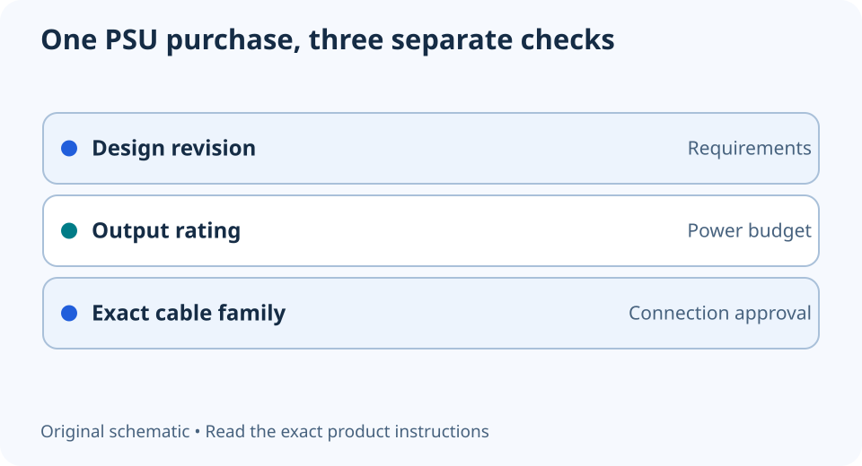

# ATX 3.1 vs ATX 3.0: which PSU details matter?

**LE-01 · Unpublished research draft · No human editorial review**

Proposed byline: PC Part Performance; requires truthful attribution confirmation.

Intent: Interpret an ATX 3.1 label without assuming a complete PSU upgrade is necessary

Description: Separate the power-supply design revision from wattage, cable compatibility and exact-card installation requirements.

Research date: 2026-10-19. This is not a publication or modification date.

## Short answer

ATX 3.1 changes parts of the power-supply specification, including the GPU connector arrangement. The label alone cannot tell you whether a particular unit has the right cables, fits the case or is a worthwhile replacement.

Original schematic; not a manufacturer wiring diagram, product measurement or benchmark.

## Three labels that answer different questions

ATX revision, continuous output and cable type describe different properties. A revision identifies a design requirement; wattage describes an output rating; the cable family identifies a connection system. Do not replace one of these checks with another. A higher revision number does not turn a wrong modular cable into a compatible one.

CORSAIR describes the transition to the 12V-2x6 GPU connector and changed hold-up requirements in ATX 3.1. That is a useful starting explanation, not an independent test of every unit bearing the label. Do not read the revision as a guarantee against a poorly seated connection or as a measured efficiency ranking.

Applicable sources: [CORSAIR: ATX 3.0 vs ATX 3.1](https://www.corsair.com/us/en/explorer/diy-builder/power-supply-units/atx-30-vs-atx-31-whats-the-difference/); [CORSAIR: PSU cable compatibility](https://www.corsair.com/us/en/s/psu-cable-compatibility).

## Check the exact purchase, not the product-family name

Record the complete PSU part number and revision from the offer. Open that revision’s manual and package list. Identify the GPU cable supplied, the CPU power cables needed by the motherboard, and any separate cable the manufacturer approves. Similar retail names can persist across hardware generations.

Then compare the actual GPU installation instructions with the case layout. The 16-pin connector, cable exit and side panel occupy space beyond the card body. A PSU standard and a GPU chip name cannot verify that routing. Keep a missing cable specification or uncertain clearance as an outstanding task rather than approving the whole build.

Applicable sources: [NVIDIA: GeForce RTX 5070 family specifications](https://www.nvidia.com/en-us/geforce/graphics-cards/50-series/rtx-5070-family/).

## Decide whether replacing a working PSU solves a real problem

Make two plans: keep the current unit with a documented supported connection, or replace it with an exact alternative. Include the replacement unit, any required mounting bracket and shipping. If the current unit’s identity, condition or cables cannot be established, do not count it as verified reusable equipment.

This is a connection-and-purchase decision worksheet. It does not test transient response, protections, noise or ageing. Use independent testing of the exact unit for those questions. A newer label may be relevant, but it should not erase evidence about an older unit or substitute for the complete requirements of your system.

- Record exact PSU revision
- Identify supplied and approved GPU cable
- Check CPU connections and case cable space
- Keep unknown condition or cable origin unresolved

## Apply this to your PC

- [Record the PSU in your build](/builder/)
- [Check the full replacement cost](/tools/platform-upgrade-cost/)

## Research evidence and limitations

### CORSAIR: ATX 3.0 vs ATX 3.1

[Original source](https://www.corsair.com/us/en/explorer/diy-builder/power-supply-units/atx-30-vs-atx-31-whats-the-difference/) · Inspected 2026-10-19

ATX 3.1 changes the GPU connector to 12V-2x6 and changes hold-up requirements.

Scope limitation: Manufacturer explanation rather than a certification test. No unit is recommended from its revision label alone; its broad efficiency/safety marketing is not repeated.

Citation and original explanation only; no source images, diagrams or benchmark tables reproduced.

### CORSAIR: PSU cable compatibility

[Original source](https://www.corsair.com/us/en/s/psu-cable-compatibility) · Inspected 2026-10-19

The 24-pin cable pinout differs between Type 3 and Type 4; Type 3/4 are not compatible with Type 5 PSUs. Incorrect modular cables can damage hardware.

Scope limitation: Only CORSAIR products in the applicable compatibility matrix. No all-brand pinout or interchangeability claim.

Citation and original explanation only; no source images, diagrams or benchmark tables reproduced.

### NVIDIA: GeForce RTX 5070 family specifications

[Original source](https://www.nvidia.com/en-us/geforce/graphics-cards/50-series/rtx-5070-family/) · Inspected 2026-10-19

Reference display connections and up-to-four-display support have qualifications; partner-card dimensions vary. GPU power-connector alternatives and installation-space requirements are model-specific.

Scope limitation: No simultaneous maximum-mode guarantee; no partner layout inferred from Founders Edition. No performance chart reused.

Citation and original explanation only; no source images, diagrams or benchmark tables reproduced.

## Editorial decision still required

Research and draft preparation assisted by AI; no human editorial review or hands-on testing claimed.

Human review: not performed. Publication approval: not granted. No public Article schema, feed, sitemap or blog entry is authorized by this file.

Check the source-linked claims, diagram, safety conditions, search-intent fit and all internal links before deciding. A person must record a truthful complete-article review and byline; automated tests are not that review.

Content fingerprint: `d6a6e922e7f7c82365faf0e6a93a7e58d5bc3fafd8a448ccdccf1d002955b7ee`
