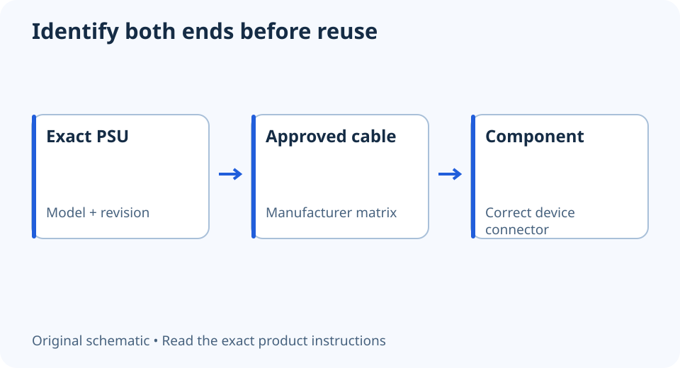

# Can you reuse modular PSU cables? Identify them first

**LE-02 · Unpublished research draft · No human editorial review**

Proposed byline: PC Part Performance; requires truthful attribution confirmation.

Intent: Decide whether an existing modular cable is documented for a replacement PSU

Description: A safe decision process for a mixed cable box: exact PSU model, cable family, documented approval and unknown origins.

Research date: 2026-10-19. This is not a publication or modification date.

## Short answer

Reuse a modular cable only when the PSU manufacturer explicitly supports that cable with the exact unit. A matching plug, familiar brand or similar wattage is not sufficient evidence.

Original schematic; not a manufacturer wiring diagram, product measurement or benchmark.

## Start at the power-supply end

The device-end connector can look familiar while the PSU-end wiring differs. CORSAIR’s matrix gives a concrete example: Type 3 and Type 4 differ at the 24-pin ATX cable, and neither family is compatible with Type 5 PSUs. The manufacturer warns that using the wrong cables can damage hardware.

This does not mean those family names apply to another brand. Nor should a cable from a different unit be accepted because it physically enters a socket. Keep the power disconnected while identifying cables; never power a component as an experiment to discover whether an unknown cable works.

Applicable sources: [CORSAIR: PSU cable compatibility](https://www.corsair.com/us/en/s/psu-cable-compatibility).

## Build a cable record you can actually verify

Put the PSU model, hardware generation and cable markings together in one photograph or note. Compare them with the current manufacturer compatibility resource. A cable’s packaging or invoice is useful only if it identifies the actual item in your hand. A loose cable next to a PSU box is not a reliable provenance record.

Separate approved cables from unknown ones before starting the build. Do not combine the sets while routing behind the motherboard tray. If the manufacturer cannot confirm an unmarked cable, use a documented replacement or the correct supplied set. Keep the uncertain cable out of the purchase and assembly plan.

Decisions for a box of spare cables

| Evidence | Decision |
| --- | --- |
| Exact cable and exact PSU explicitly approved | Eligible for the documented use; inspect condition too |
| Same manufacturer, unclear generation | Unverified; check the exact matrix or support |
| Plug fits, markings absent | Do not use it to test compatibility |

## Recheck after the PSU changes

A case or GPU upgrade can leave neatly routed old cables in place. Treat a PSU replacement as a new cable-identification task, even when the new unit has a similar name. Label the cable set you remove with the old PSU model so that future you does not inherit the same uncertainty.

Keep extension cables conceptually separate from modular replacement cables: they attach at different points. An extension still needs documented electrical and connector suitability, but its presence does not establish the PSU-side cable’s identity. If a connector is damaged, discoloured or has an uncertain repair, stop and obtain manufacturer guidance rather than adapting it.

Applicable sources: [CORSAIR: PSU cable compatibility](https://www.corsair.com/us/en/s/psu-cable-compatibility).

## Apply this to your PC

- [Save the PSU identity and notes](/builder/)
- [Plan reused components](/upgrade/)

## Research evidence and limitations

### CORSAIR: PSU cable compatibility

[Original source](https://www.corsair.com/us/en/s/psu-cable-compatibility) · Inspected 2026-10-19

The 24-pin cable pinout differs between Type 3 and Type 4; Type 3/4 are not compatible with Type 5 PSUs. Incorrect modular cables can damage hardware.

Scope limitation: Only CORSAIR products in the applicable compatibility matrix. No all-brand pinout or interchangeability claim.

Citation and original explanation only; no source images, diagrams or benchmark tables reproduced.

## Editorial decision still required

Research and draft preparation assisted by AI; no human editorial review or hands-on testing claimed.

Human review: not performed. Publication approval: not granted. No public Article schema, feed, sitemap or blog entry is authorized by this file.

Check the source-linked claims, diagram, safety conditions, search-intent fit and all internal links before deciding. A person must record a truthful complete-article review and byline; automated tests are not that review.

Content fingerprint: `f3f170d65fca10e5b8bea8db6a32dd85715b3918b544e941ad0f02959c1fb9ef`
