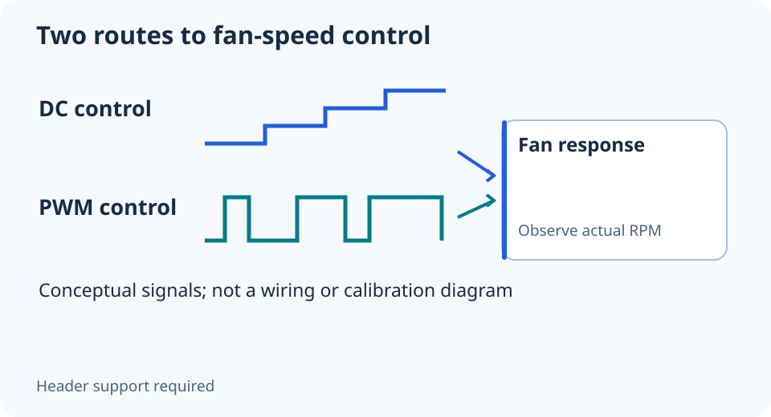

# PWM vs DC fans: why the control mode matters

**LE-03 · Unpublished research draft · No human editorial review**

Proposed byline: PC Part Performance; requires truthful attribution confirmation.

Intent: Match 3-pin or 4-pin fan control to the motherboard header mode

Description: Identify fan power, speed reporting and control so a fan curve does not become a guessing game.

Research date: 2026-10-19. This is not a publication or modification date.

## Short answer

PWM and DC describe different ways to control a fan. Match the fan and the header’s supported mode, then verify its response; the number shown on a curve is not automatically the resulting RPM.

Original schematic; not a manufacturer wiring diagram, product measurement or benchmark.

## Power, reporting and control have separate jobs

A conventional 3-pin fan has power, ground and a speed-reporting connection. Voltage-based control changes its supplied voltage. A 4-pin PWM fan adds a control signal. Noctua explains that its 4-pin fan can connect to a 3-pin header, but without PWM it may run at full speed unless that header supports voltage control.

That distinction explains why drawing a fan curve may appear to do nothing. Before blaming the fan, identify the actual header and its selected mode in the exact motherboard manual. The setting may be called DC, voltage or PWM. Do not assume Auto identified an unusual fan or hub correctly.

Applicable sources: [Noctua: 3-pin fans and 4-pin PWM connectors](https://www.noctua.at/en/support/faqs/can-i-run-noctua-3-pin-fans-on-4-pin-pwm-connectors-or-4-pin-fans-on-3-pin-connectors).

## Do not confuse lighting with motor control

A lit fan can still have a disconnected motor cable. A spinning fan can have no lighting connection. Identify those systems separately, especially with a hub or a proprietary combined connector. The drawing here shows signal roles, not a universal wiring pinout for every fan or controller.

Before using a splitter, check the header’s documented load limit against the connected fans and the hub instructions. A header label alone is not evidence that it can power an arbitrary number of motors. Do not assume a powered hub reports each fan individually; inspect the hub’s monitoring arrangement.

Applicable sources: [MSI: Motherboard ports and headers](https://www.msi.com/blog/what-are-the-functions-of-motherboard-ports-and-headers).

## Verify a curve without losing the baseline

Record the original mode, curve and observed fan behavior. Change one supported setting and allow a repeatable workload to settle. Watch both the reported speed and actual cooling behavior; a valid tachometer reading does not establish a safe temperature or whole-system acoustic quality.

If the fan fails to start reliably, reports implausible speed or behaves differently from the manufacturer’s instructions, return to the known working configuration. Do not keep reducing voltage until a motor stalls or copy another PC’s minimum duty cycle. Save the fan model, header and final supported settings with the build so later maintenance is understandable.

- Fan motor connector identified
- Lighting connection checked separately
- Header mode and current limit documented
- Starting behavior and workload response observed

## Apply this to your PC

- [Choose and record case fans](/builder/)
- [Keep configuration notes](/my-pc/)

## Research evidence and limitations

### Noctua: 3-pin fans and 4-pin PWM connectors

[Original source](https://www.noctua.at/en/support/faqs/can-i-run-noctua-3-pin-fans-on-4-pin-pwm-connectors-or-4-pin-fans-on-3-pin-connectors) · Inspected 2026-10-19

3-pin speed control depends on supplied voltage; a 4-pin fan on a 3-pin header lacks its PWM control signal and can run at full speed unless voltage control is supported.

Scope limitation: No universal BIOS menu, fan stopping voltage, header current rating or RPM-to-duty conversion.

Citation and original explanation only; no source images, diagrams or benchmark tables reproduced.

### MSI: Motherboard ports and headers

[Original source](https://www.msi.com/blog/what-are-the-functions-of-motherboard-ports-and-headers) · Inspected 2026-10-19

Front-panel switch/LED, USB Type-A, USB Type-C, audio and supplemental USB PD connections have different purposes.

Scope limitation: General naming examples only; exact pinout, current limits and available functions require the selected board manual.

Citation and original explanation only; no source images, diagrams or benchmark tables reproduced.

## Editorial decision still required

Research and draft preparation assisted by AI; no human editorial review or hands-on testing claimed.

Human review: not performed. Publication approval: not granted. No public Article schema, feed, sitemap or blog entry is authorized by this file.

Check the source-linked claims, diagram, safety conditions, search-intent fit and all internal links before deciding. A person must record a truthful complete-article review and byline; automated tests are not that review.

Content fingerprint: `5299d2d9f7b94d3e5ea5b7da48f7fc8cbe08f0c86cd71f7e68da17c139f4a842`
