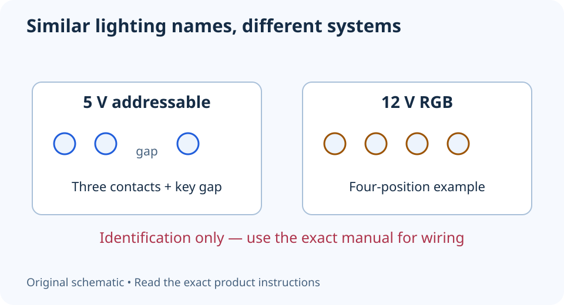

# 5 V ARGB vs 12 V RGB: check before connecting

**LE-04 · Unpublished research draft · No human editorial review**

Proposed byline: PC Part Performance; requires truthful attribution confirmation.

Intent: Prevent a 5 V lighting device being connected to the wrong 12 V header

Description: Identify lighting voltage, connector type and controller requirements without treating similar RGB labels as interchangeable.

Research date: 2026-10-19. This is not a publication or modification date.

## Short answer

5 V addressable lighting and 12 V RGB lighting are different electrical systems. Match the device, header and controller using their manuals before connecting anything.

Original schematic; not a manufacturer wiring diagram, product measurement or benchmark.

## The voltage label matters more than the colour effect

ARGB usually describes individually addressable lighting, while conventional RGB changes channels together. More importantly for installation, the familiar desktop arrangements use different voltage and connector systems. ASUS’s header guidance explicitly separates 5 V Addressable Gen2 from 12 V AURA RGB and directs readers to the exact manual.

The connector sketch below is an identification aid, not permission to wire a product from memory. Some lighting ecosystems use proprietary connectors and hubs. Read the actual voltage and connection instructions; a three-pin shape or an RGB product name cannot prove compatibility across every system.

Applicable sources: [ASUS: Connecting 5 V and 12 V RGB cables](https://www.asus.com/tw/support/faq/1056087/).

## Identify the header on your exact board

Use the board model and revision to find the manual. MSI’s PRO B760-VC WIFI II guide has separate JRGB and JARGB sections; those are not names you can assume on another board. Find the specified header in the board layout, then confirm the markings on the physical board.

Record the connected devices and the applicable header or hub limit. Do not copy the current or LED allowance from an example board into your own plan. Splitters increase the attached load, and a connector adaptor does not necessarily convert voltage or signalling. If the device documentation and board manual do not agree, leave it disconnected and ask the manufacturer.

Applicable sources: [MSI: PRO B760-VC WIFI II user guide](https://download-2.msi.com/archive/mnu_exe/mb/PROB760-VCWIFIII_EN.pdf).

## Separate the hub’s power and control paths

A lighting controller can require external power and a separate motherboard control lead. List each connection instead of assuming one cable provides everything. Also check whether the controller needs its own software or supports motherboard synchronization. The fan motor may have a different cable and control system altogether.

Shut the PC down and follow the manuals’ power-disconnection precautions before changing internal wiring. Do not hot-plug lighting to test an uncertain combination. If you replace a motherboard, revisit this check even when you keep the same case and fans. Save a simple connection record so future troubleshooting starts from known identities.

- Device voltage recorded
- Header or hub model identified
- Polarity and connector orientation checked in manual
- Attached load within that exact controller’s documented limit

## Apply this to your PC

- [Record fans and controllers](/builder/)
- [Save wiring notes](/my-pc/)

## Research evidence and limitations

### ASUS: Connecting 5 V and 12 V RGB cables

[Original source](https://www.asus.com/tw/support/faq/1056087/) · Inspected 2026-10-19

The named-board example distinguishes 5 V Addressable Gen2 from 12 V AURA RGB headers; manuals identify the correct header and voltage orientation.

Scope limitation: Traditional Chinese full text inspected. Board-specific LED/current limits are not generalized. The English regional endpoints were unavailable during this check.

Citation and original explanation only; no source images, diagrams or benchmark tables reproduced.

### MSI: PRO B760-VC WIFI II user guide

[Original source](https://download-2.msi.com/archive/mnu_exe/mb/PROB760-VCWIFIII_EN.pdf) · Inspected 2026-10-19

Printed page 32 labels JFP1 switch/LED functions; page 35 identifies JUSB1 as USB 3.2 Gen 1 Type-C; pages 40–41 distinguish 12 V JRGB and 5 V ARGB.

Scope limitation: Exact named board only. Original illustrations are not copied. PDF text inspected; screenshot fetch succeeded for page 32 and failed for later pages, so no uninspected graphical wiring detail is adopted.

Citation and original explanation only; no source images, diagrams or benchmark tables reproduced.

## Editorial decision still required

Research and draft preparation assisted by AI; no human editorial review or hands-on testing claimed.

Human review: not performed. Publication approval: not granted. No public Article schema, feed, sitemap or blog entry is authorized by this file.

Check the source-linked claims, diagram, safety conditions, search-intent fit and all internal links before deciding. A person must record a truthful complete-article review and byline; automated tests are not that review.

Content fingerprint: `99b6fd5d259380ee27075edfca927f0f66cb79350a21b4ae75b36d3fbb1b32ee`
