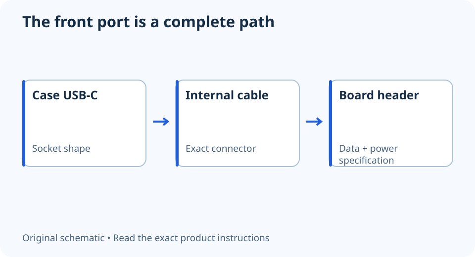

# Will your case’s front USB-C port work?

**LE-05 · Unpublished research draft · No human editorial review**

Proposed byline: PC Part Performance; requires truthful attribution confirmation.

Intent: Check a case front USB-C connection against the exact motherboard header

Description: Trace the case port, internal cable, motherboard header, speed and power requirements before buying an adapter.

Research date: 2026-10-19. This is not a publication or modification date.

## Short answer

A front USB-C socket needs the right internal connection. The port shape does not establish data rate, charging power or display support.

Original schematic; not a manufacturer wiring diagram, product measurement or benchmark.

## Trace the whole path

Start at the case’s front port and identify the cable inside the chassis. Find the matching header in the motherboard manual. Then check the data specification and any power requirements at both ends. A rear USB-C port does not prove the motherboard has the internal header needed by the case.

A useful example is MSI’s PRO B760-VC WIFI II: its manual calls JUSB1 a USB 3.2 Gen 1 Type-C front-panel connector. That is a board-specific capability, not a claim that every Type-C header has the same speed. An internal header’s shape must not replace its specification.

Applicable sources: [MSI: PRO B760-VC WIFI II user guide](https://download-2.msi.com/archive/mnu_exe/mb/PROB760-VCWIFIII_EN.pdf).

## Keep data, charging and display separate

Make three columns in your port plan: data, charging and video. Leave unsupported or undocumented functions marked unknown. Do not infer DisplayPort Alternate Mode from a case’s Type-C socket or assume high-power charging from a modern USB generation.

MSI’s general header guide distinguishes the front Type-C connection from a supplemental power input used on some models for front-port charging. That extra input is not universal. Check whether it exists and is required on the exact board before counting a charging feature or adding a cable.

Applicable sources: [MSI: Motherboard ports and headers](https://www.msi.com/blog/what-are-the-functions-of-motherboard-ports-and-headers).

## Treat an adapter as another specified component

If the case and board do not match, compare an appropriate documented adapter, leaving the port unused, or choosing different hardware. Record what the adapter preserves and what it loses. It may change the speed or consume a header needed by another port; a mechanical fit alone does not settle those tradeoffs.

Before ordering, check the cable’s reach and the space around the header with the GPU installed. Avoid forced bends or blocked latches. Keep the exact case cable, board header and adapter model together in the build notes. A working front port should be the result of a documented path, not a surprise discovered after assembly.

A front-port connection record

| Check | What to record |
| --- | --- |
| Case | Port and supplied internal cable |
| Motherboard | Exact header and documented data rate |
| Power | Charging support and extra input if required |
| Adapter | Exact model, supported functions and occupied header |

## Apply this to your PC

- [Check the case and motherboard together](/builder/)
- [Compare motherboard specifications](/compare/)

## Research evidence and limitations

### MSI: PRO B760-VC WIFI II user guide

[Original source](https://download-2.msi.com/archive/mnu_exe/mb/PROB760-VCWIFIII_EN.pdf) · Inspected 2026-10-19

Printed page 32 labels JFP1 switch/LED functions; page 35 identifies JUSB1 as USB 3.2 Gen 1 Type-C; pages 40–41 distinguish 12 V JRGB and 5 V ARGB.

Scope limitation: Exact named board only. Original illustrations are not copied. PDF text inspected; screenshot fetch succeeded for page 32 and failed for later pages, so no uninspected graphical wiring detail is adopted.

Citation and original explanation only; no source images, diagrams or benchmark tables reproduced.

### MSI: Motherboard ports and headers

[Original source](https://www.msi.com/blog/what-are-the-functions-of-motherboard-ports-and-headers) · Inspected 2026-10-19

Front-panel switch/LED, USB Type-A, USB Type-C, audio and supplemental USB PD connections have different purposes.

Scope limitation: General naming examples only; exact pinout, current limits and available functions require the selected board manual.

Citation and original explanation only; no source images, diagrams or benchmark tables reproduced.

## Editorial decision still required

Research and draft preparation assisted by AI; no human editorial review or hands-on testing claimed.

Human review: not performed. Publication approval: not granted. No public Article schema, feed, sitemap or blog entry is authorized by this file.

Check the source-linked claims, diagram, safety conditions, search-intent fit and all internal links before deciding. A person must record a truthful complete-article review and byline; automated tests are not that review.

Content fingerprint: `d2cd381718b40865df933f30bed65f0da89efbe7491161934c257ff99f59c595`
