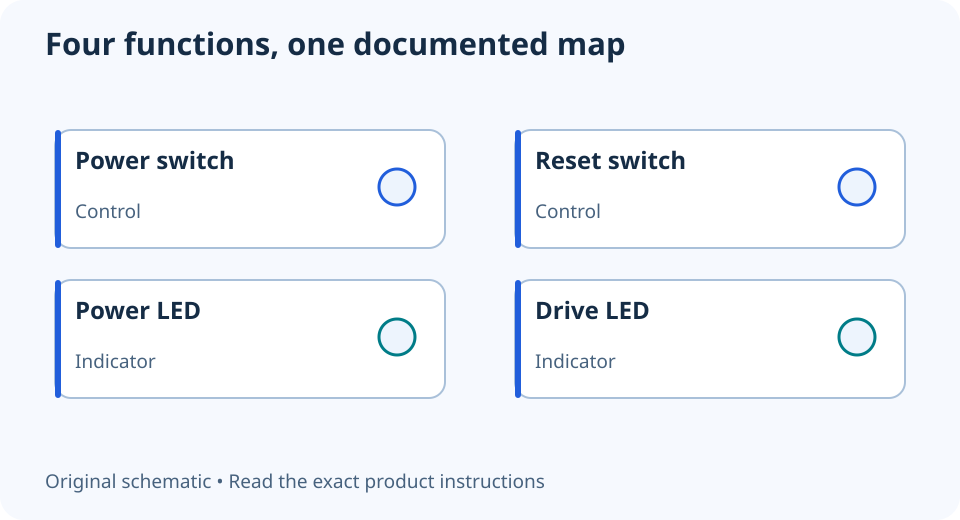

# Front-panel power and LED cables: make a connection map

**LE-06 · Unpublished research draft · No human editorial review**

Proposed byline: PC Part Performance; requires truthful attribution confirmation.

Intent: Map a case’s switch and LED leads to the documented motherboard front-panel header

Description: Read the case labels and exact motherboard header diagram before attaching power, reset and indicator leads.

Research date: 2026-10-19. This is not a publication or modification date.

## Short answer

Use the exact motherboard diagram to identify each front-panel connection. The power switch, reset switch, power LED and drive LED have different jobs even when their small plugs look similar.

Original schematic; not a manufacturer wiring diagram, product measurement or benchmark.

## Collect identities before reaching inside the case

Put the case manual and motherboard manual side by side. Read the labels on the case leads and locate the front-panel header in the board overview. Photograph the labels while they are still visible. A generic internet picture can be mirrored, rotated or simply describe another header.

For a concrete reference, the PRO B760-VC WIFI II manual labels JFP1 switch and LED functions on printed page 32. That page is the source for that board, not a universal numbered pinout. The conceptual drawing in this guide groups functions without pretending to be an installation diagram.

Applicable sources: [MSI: PRO B760-VC WIFI II user guide](https://download-2.msi.com/archive/mnu_exe/mb/PROB760-VCWIFIII_EN.pdf).

## Switches and indicators are not the same thing

The case’s power and reset buttons are controls; the LEDs are indicators. Use the manual’s polarity markings for the LED leads. Do not move an unknown plug between headers while the system is powered, and do not confuse the front-panel block with USB, audio or lighting connections.

A combined case plug may be convenient only if its layout matches the board. Check any supplied breakout adapter against both manuals. If a case lacks a reset button or drive indicator, an unused supported function can be normal; it does not mean you need to populate every pin on the header.

Applicable sources: [MSI: Motherboard ports and headers](https://www.msi.com/blog/what-are-the-functions-of-motherboard-ports-and-headers).

## Verify one symptom at a time

After finishing the manufacturer’s assembly checks, verify the power button and observe the indicators. A dark LED and a PC that will not power on are different symptoms. Preserve the current connection record before making a correction, and disconnect power as the manual requires before touching internal leads.

Do not bridge unknown pins with a screwdriver as a general troubleshooting shortcut. If labels are missing or the case uses a proprietary block, stop at identification and obtain the correct documentation. A tidy map of function, case label and manual location is more useful than memorizing a pin pattern that may not apply to the next motherboard.

- Exact header found in board manual
- Case leads mapped by function
- LED polarity checked
- Unused functions identified deliberately
- Power disconnected before changes

## Apply this to your PC

- [Keep the board and case plan](/builder/)
- [Follow the assembly learning path](/build-school/)

## Research evidence and limitations

### MSI: PRO B760-VC WIFI II user guide

[Original source](https://download-2.msi.com/archive/mnu_exe/mb/PROB760-VCWIFIII_EN.pdf) · Inspected 2026-10-19

Printed page 32 labels JFP1 switch/LED functions; page 35 identifies JUSB1 as USB 3.2 Gen 1 Type-C; pages 40–41 distinguish 12 V JRGB and 5 V ARGB.

Scope limitation: Exact named board only. Original illustrations are not copied. PDF text inspected; screenshot fetch succeeded for page 32 and failed for later pages, so no uninspected graphical wiring detail is adopted.

Citation and original explanation only; no source images, diagrams or benchmark tables reproduced.

### MSI: Motherboard ports and headers

[Original source](https://www.msi.com/blog/what-are-the-functions-of-motherboard-ports-and-headers) · Inspected 2026-10-19

Front-panel switch/LED, USB Type-A, USB Type-C, audio and supplemental USB PD connections have different purposes.

Scope limitation: General naming examples only; exact pinout, current limits and available functions require the selected board manual.

Citation and original explanation only; no source images, diagrams or benchmark tables reproduced.

## Editorial decision still required

Research and draft preparation assisted by AI; no human editorial review or hands-on testing claimed.

Human review: not performed. Publication approval: not granted. No public Article schema, feed, sitemap or blog entry is authorized by this file.

Check the source-linked claims, diagram, safety conditions, search-intent fit and all internal links before deciding. A person must record a truthful complete-article review and byline; automated tests are not that review.

Content fingerprint: `18fab72614ce1df9fe4fa4626d4128f542bd1d66d15d52688fea3f05ddf51d93`
