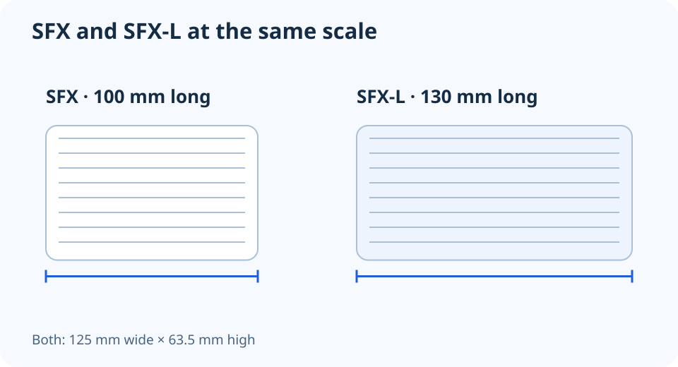

# SFX vs SFX-L: the extra length is only part of the fit check

**LE-07 · Unpublished research draft · No human editorial review**

Proposed byline: PC Part Performance; requires truthful attribution confirmation.

Intent: Choose between SFX and SFX-L with an explicit cable-routing envelope

Description: Compare compact PSU envelopes, mounting support and the cable space that a case specification may not show.

Research date: 2026-10-19. This is not a publication or modification date.

## Short answer

SFX-L keeps the familiar compact width and height but extends the body length. Check the exact case allowance, bracket and cable exit before assuming a supported PSU label means a comfortable installation.

Original schematic; not a manufacturer wiring diagram, product measurement or benchmark.

## Use dimensions with named axes

CORSAIR’s form-factor explanation gives SFX as 125 mm wide, 63.5 mm high and 100 mm long; SFX-L extends that length to 130 mm. The same-scale illustration below shows that 30 mm difference. It does not depict a real case or certify a complete build.

Copy the exact PSU’s published dimensions into the plan. ATX supplies can have different body lengths, so an ATX label is not a single comparison length. Also check the bracket: a case may accept a compact supply directly, require an adapter, or impose position-specific restrictions.

Applicable sources: [CORSAIR: Difference between SFX and SFX-L power supplies](https://www.corsair.com/ca/en/explorer/diy-builder/power-supply-units/whats-the-difference-between-sfx-and-sfx-l-power-supplies/).

## Body fit and working space are different checks

Mark the modular connector end in your case layout. Ask where the cable can leave the unit, where it turns, and what occupies the next area: a GPU, radiator, drive cage or front fan. The extra SFX-L body length can consume space that an SFX unit leaves for those connections.

Use only documented or measured dimensions for the actual configuration. Do not invent a universal cable-bend allowance. A listed maximum PSU length may exclude the cable space you need, or depend on moving another bracket. If the manual does not settle the arrangement, keep that clearance unresolved and ask the case manufacturer.

## Compare the complete purchase

Do not infer acoustic quality from a larger fan or smaller enclosure. If noise is part of the decision, look for comparable testing of the exact PSU and operating load. For the purchase list, include any required bracket and an approved cable set; a compact enclosure does not establish electrical compatibility.

Before final assembly, retain access to the PSU switch, intake and connectors as the case instructions require. Store the chosen mounting location and cable route with the build revision. If the GPU or radiator changes later, review the shared space again rather than treating the original PSU fit decision as permanent.

A compact PSU fit record

| Dimension or condition | Check |
| --- | --- |
| Body envelope | Exact model width, height and length |
| Mount | Case bracket and permitted orientation |
| Cable exit | Manufacturer guidance and nearby components |
| Ventilation | Intake and exhaust remain unobstructed |

## Apply this to your PC

- [Plan PSU, case and GPU together](/builder/)
- [Record unresolved fit checks](/compatibility/)

## Research evidence and limitations

### CORSAIR: Difference between SFX and SFX-L power supplies

[Original source](https://www.corsair.com/ca/en/explorer/diy-builder/power-supply-units/whats-the-difference-between-sfx-and-sfx-l-power-supplies/) · Inspected 2026-10-19

SFX envelope 100 × 125 × 63.5 mm; SFX-L 130 × 125 × 63.5 mm.

Scope limitation: Use exact product dimensions and mounting rules. The article’s historical cable-family generalization is not used for newer revisions.

Citation and original explanation only; no source images, diagrams or benchmark tables reproduced.

## Editorial decision still required

Research and draft preparation assisted by AI; no human editorial review or hands-on testing claimed.

Human review: not performed. Publication approval: not granted. No public Article schema, feed, sitemap or blog entry is authorized by this file.

Check the source-linked claims, diagram, safety conditions, search-intent fit and all internal links before deciding. A person must record a truthful complete-article review and byline; automated tests are not that review.

Content fingerprint: `64958509042e95e2f24740f1fe9874044378eae2e18d132a4ec7fb2181a1ad60`
