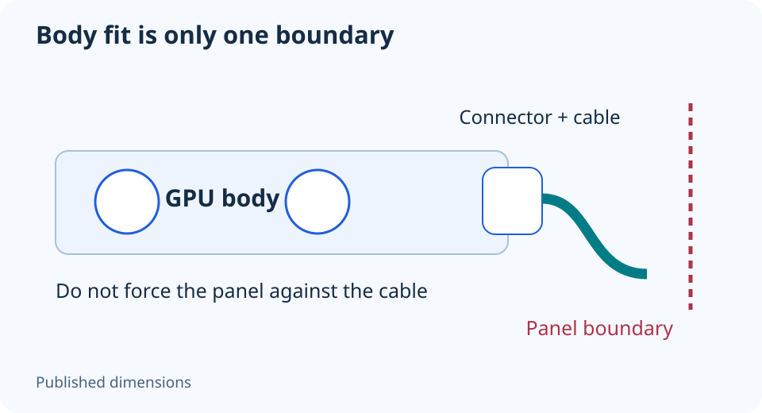

# GPU power-cable clearance: check the side panel too

**LE-08 · Unpublished research draft · No human editorial review**

Proposed byline: PC Part Performance; requires truthful attribution confirmation.

Intent: Document GPU power cable routing beyond the card-body dimensions

Description: Plan connector seating, cable exit and panel space without using a universal bend-distance rule.

Research date: 2026-10-19. This is not a publication or modification date.

## Short answer

A card can fit the expansion slots while its power cable conflicts with the side panel. Check the exact GPU, approved cable and installation instructions together before closing the case.

Original schematic; not a manufacturer wiring diagram, product measurement or benchmark.

## The card body is not the whole occupied space

NVIDIA’s RTX 5070 family page separates card dimensions, power connections and installation requirements; partner models can differ. That is why a chip name cannot supply the dimensions or cable exit of an ASUS, MSI or other partner card. Find the documentation for the product you will actually receive.

Sketch the connector location and the space between that edge of the card and the closed panel. Record the cable’s permitted routing from its manufacturer. A generic 3D preview can help you notice the question, but it cannot establish the cable’s installed envelope or certify a bend you have not measured.

Applicable sources: [NVIDIA: GeForce RTX 5070 family specifications](https://www.nvidia.com/en-us/geforce/graphics-cards/50-series/rtx-5070-family/).

## Separate electrical approval from mechanical routing

First identify the supported power connection and PSU cable family. Then check the physical routing. A cable can be documented for a PSU yet still lack space in the chosen chassis. Conversely, an adapter that appears to solve a bend is not acceptable without explicit product compatibility.

Do not use the side panel to force a connector or cable into position. Follow the exact installation instructions for insertion, seating and strain relief. Avoid borrowing a bend distance from another cable, an older GPU or an uncited diagram. Where guidance is missing or contradictory, preserve the unresolved task and ask the relevant manufacturer.

Applicable sources: [CORSAIR: PSU cable compatibility](https://www.corsair.com/us/en/s/psu-cable-compatibility).

## Make the check repeatable after a swap

Save the GPU part number, PSU model, cable model and case layout with a clear photograph of the completed routing where safe. Do not publish serial numbers or private receipts merely to share the build. Record whether the panel was checked in its final closed configuration.

A new GPU, vertical mount or radiator can change the space and cable tension, so recheck after those swaps. Stop using damaged, discoloured or loose connections and seek manufacturer support. This guide makes no claim that a particular connector revision eliminates installation risk or that visual inspection proves the complete electrical system healthy.

- Exact partner GPU identified
- PSU-side cable approved
- Seating checked to product instructions
- Closed-panel space verified
- No pressure used to force routing

## Apply this to your PC

- [Plan the exact card and case](/builder/)
- [Open the fit checks](/compatibility/)

## Research evidence and limitations

### NVIDIA: GeForce RTX 5070 family specifications

[Original source](https://www.nvidia.com/en-us/geforce/graphics-cards/50-series/rtx-5070-family/) · Inspected 2026-10-19

Reference display connections and up-to-four-display support have qualifications; partner-card dimensions vary. GPU power-connector alternatives and installation-space requirements are model-specific.

Scope limitation: No simultaneous maximum-mode guarantee; no partner layout inferred from Founders Edition. No performance chart reused.

Citation and original explanation only; no source images, diagrams or benchmark tables reproduced.

### CORSAIR: PSU cable compatibility

[Original source](https://www.corsair.com/us/en/s/psu-cable-compatibility) · Inspected 2026-10-19

The 24-pin cable pinout differs between Type 3 and Type 4; Type 3/4 are not compatible with Type 5 PSUs. Incorrect modular cables can damage hardware.

Scope limitation: Only CORSAIR products in the applicable compatibility matrix. No all-brand pinout or interchangeability claim.

Citation and original explanation only; no source images, diagrams or benchmark tables reproduced.

## Editorial decision still required

Research and draft preparation assisted by AI; no human editorial review or hands-on testing claimed.

Human review: not performed. Publication approval: not granted. No public Article schema, feed, sitemap or blog entry is authorized by this file.

Check the source-linked claims, diagram, safety conditions, search-intent fit and all internal links before deciding. A person must record a truthful complete-article review and byline; automated tests are not that review.

Content fingerprint: `6b2e3eab892f1c51960cc6a1a2bd86eceb34dd00567c7045298ba61bd7bbe79f`
