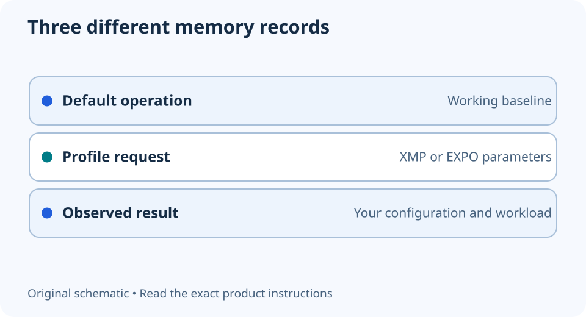

# XMP and EXPO: record the default before changing the profile

**LE-09 · Unpublished research draft · No human editorial review**

Proposed byline: PC Part Performance; requires truthful attribution confirmation.

Intent: Make an informed, reversible memory-profile decision rather than copy an unsupported setting

Description: Understand what a memory profile changes, verify support and preserve a working baseline before enabling it.

Research date: 2026-10-19. This is not a publication or modification date.

## Short answer

XMP and EXPO are memory overclocking profile systems. A kit’s advertised profile is not the same as the CPU’s standard memory specification or proof that your complete configuration is stable.

Original schematic; not a manufacturer wiring diagram, product measurement or benchmark.

## A profile is a configuration, not extra capacity

Intel describes XMP as predefined memory-overclocking profiles; AMD describes EXPO as its memory-overclocking technology. Both still depend on compatible hardware and firmware. A profile can change operating parameters, but it does not create more RAM capacity or upgrade DDR generation.

Separate the module’s default/SPD operation, advertised profile and processor’s published support. Do not compare a profile transfer rate with a standard support figure as though they are the same guarantee. Manufacturer warranty conditions can be affected by operating outside specifications; check the terms for the actual parts.

Applicable sources: [Intel: Extreme Memory Profile](https://www.intel.com/content/www/us/en/gaming/extreme-memory-profile-xmp.html); [AMD: EXPO technology](https://www.amd.com/en/products/processors/technologies/expo.html).

## Save a baseline that can be restored

Record CPU, board revision, firmware, complete memory-kit number, module count and occupied slots. Observe the detected capacity and current settings before changing anything. Keep a photograph of the original firmware configuration and the exact board’s supported reset procedure.

Establish whether the PC is reliable at its existing settings using your normal work. If it already crashes or loses data, a faster profile is not the first repair. Resolve that problem before using it as the baseline for an experiment. Back up important work and avoid changing unrelated CPU or GPU settings at the same time.

## Validate the result for your workload

If you choose a documented profile, follow the board instructions and allow its stated training process. Confirm detected capacity, configuration and behavior after restart. Booting once is not a stability certificate. Check the workloads you actually use and retain the baseline for comparison.

If problems begin, use the documented route back to the known configuration. Do not add voltage or copy timings from another kit as a generic fix. A profile that works with two modules may not work after adding more. Save the final result as an observed configuration, including failures, rather than asserting that every kit with the same speed label will behave identically.

- Default settings recorded
- Exact CPU/board/kit support checked
- Warranty and recovery procedure understood
- Only one change made
- Actual workload checked after the change

## Apply this to your PC

- [Record your memory configuration](/builder/)
- [Keep the previous revision](/my-pc/)

## Research evidence and limitations

### Intel: Extreme Memory Profile

[Original source](https://www.intel.com/content/www/us/en/gaming/extreme-memory-profile-xmp.html) · Inspected 2026-10-19

XMP stores predefined memory overclocking profiles; compatible memory, board and CPU are required; operation beyond specifications can affect warranty.

Scope limitation: No universal frequency, voltage, certification or stability promise.

Citation and original explanation only; no source images, diagrams or benchmark tables reproduced.

### AMD: EXPO technology

[Original source](https://www.amd.com/en/products/processors/technologies/expo.html) · Inspected 2026-10-19

EXPO is memory overclocking technology, with supported configurations and manufacturer warranty caveats.

Scope limitation: No marketing performance uplift imported. A memory profile is not a guarantee for an arbitrary CPU/board/kit combination.

Citation and original explanation only; no source images, diagrams or benchmark tables reproduced.

## Editorial decision still required

Research and draft preparation assisted by AI; no human editorial review or hands-on testing claimed.

Human review: not performed. Publication approval: not granted. No public Article schema, feed, sitemap or blog entry is authorized by this file.

Check the source-linked claims, diagram, safety conditions, search-intent fit and all internal links before deciding. A person must record a truthful complete-article review and byline; automated tests are not that review.

Content fingerprint: `562d262c07a4629adf06432b9ddea13bbc56fbf4ac781aa96e708972ca94ef68`
