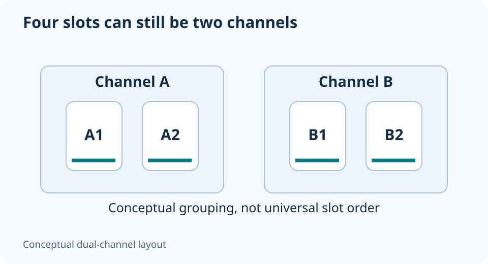

# Two DDR5 sticks vs four: capacity and supported speed

**LE-10 · Unpublished research draft · No human editorial review**

Proposed byline: PC Part Performance; requires truthful attribution confirmation.

Intent: Compare two- and four-module DDR5 configurations using exact CPU and board evidence

Description: Understand channels, ranks and module count before filling the remaining slots or mixing memory kits.

Research date: 2026-10-19. This is not a publication or modification date.

## Short answer

Four DIMM slots do not mean four memory channels or the same supported speed with every slot occupied. Check the exact CPU’s configuration table and the board’s kit support before adding modules.

Original schematic; not a manufacturer wiring diagram, product measurement or benchmark.

## Count modules, channels and ranks separately

A module is a physical DIMM. A channel is a memory-controller connection. Rank is another organization within the module. These labels answer different questions; four sticks on a dual-channel desktop do not turn it into a four-channel workstation.

AMD’s Ryzen 9 9950X provides a useful exact example: it lists two channels and DDR5-5600 for its 2×1R/2×2R entries, versus DDR5-3600 for 4×1R/4×2R. Those are published standard limits for that CPU, not measured overclocking outcomes or limits to apply to every Ryzen model.

Applicable sources: [AMD: Ryzen 9 9950X specifications](https://www.amd.com/en/products/processors/desktops/ryzen/9000-series/amd-ryzen-9-9950x.html).

## Another kit is another configuration

A second kit with a similar label is not automatically the first kit with more capacity. Kingston specifically does not support mixing its FURY overclocking kits. Preserve the actual kit number, module count and validated arrangement when comparing options.

Price two alternatives: an adequately sized matched two-module kit, and a supported four-module arrangement when one is actually documented. Include the opportunity to keep the existing setup if capacity is sufficient. Do not treat empty slots as a defect or buy more RAM solely to fill the board visually.

Applicable sources: [Kingston: Non-binary memory FAQs](https://www.kingston.com/en/blog/system-builder/24gbit-memory-faq).

## Plan capacity first, then the supported arrangement

Record the workload that needs more memory and how much capacity it actually requires. Check maximum total capacity, per-module support, slot order and firmware requirements. Capacity compatibility and an overclocking profile are separate tasks; passing one does not settle the other.

After installation, verify the detected total and operating configuration before performance comparisons. Keep training or boot failures in the record and return to the documented baseline when necessary. The best arrangement is one supported by the exact platform and useful for the workload, not simply the one with the greatest module count.

Do not interchange these labels

| Label | Meaning |
| --- | --- |
| Four slots | Physical places on the board |
| Two channels | Memory-controller topology in this CPU example |
| 1R or 2R | Module rank organization |
| XMP/EXPO profile | Requested operating configuration; separate validation |

## Apply this to your PC

- [Compare complete memory arrangements](/builder/)
- [Keep or replace an existing kit](/upgrade/)

## Research evidence and limitations

### AMD: Ryzen 9 9950X specifications

[Original source](https://www.amd.com/en/products/processors/desktops/ryzen/9000-series/amd-ryzen-9-9950x.html) · Inspected 2026-10-19

Two memory channels, DDR5 UDIMM; 2×1R/2×2R DDR5-5600 versus 4×1R/4×2R DDR5-3600 maximum-memory-speed entries; ECC requires board support.

Scope limitation: One exact CPU. Rank is not synonymous with a module’s capacity or with a channel. Not overclocking results or a universal rule for all Ryzen models.

Citation and original explanation only; no source images, diagrams or benchmark tables reproduced.

### Kingston: Non-binary memory FAQs

[Original source](https://www.kingston.com/en/blog/system-builder/24gbit-memory-faq) · Inspected 2026-10-19

24 Gbit DRAM enables capacities including 24 and 48 GB; platform firmware and exact module support must be checked; mixing FURY overclocking kits is not supported by Kingston.

Scope limitation: The historical platform list is not treated as complete current support. No two independently purchased kits are certified as one kit.

Citation and original explanation only; no source images, diagrams or benchmark tables reproduced.

## Editorial decision still required

Research and draft preparation assisted by AI; no human editorial review or hands-on testing claimed.

Human review: not performed. Publication approval: not granted. No public Article schema, feed, sitemap or blog entry is authorized by this file.

Check the source-linked claims, diagram, safety conditions, search-intent fit and all internal links before deciding. A person must record a truthful complete-article review and byline; automated tests are not that review.

Content fingerprint: `e58b0d4ff2fd1c1f74a38f87aea25401ba1c43113fb0d59ca894941ef4d54ee6`
