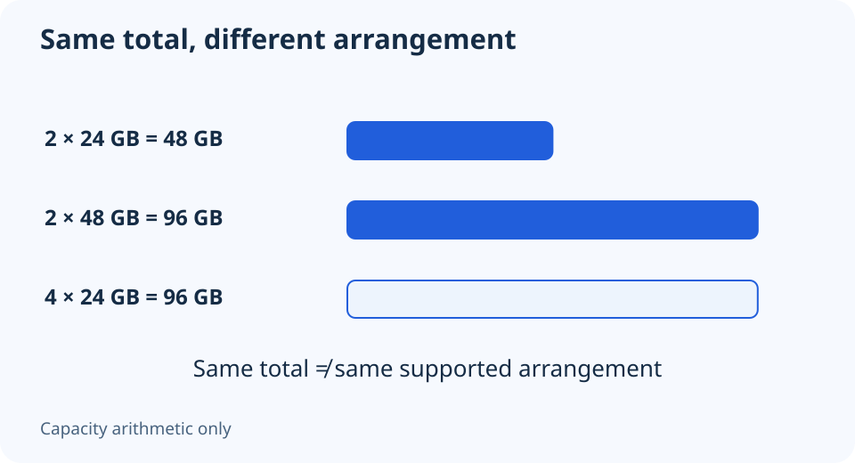

# 24 GB and 48 GB DDR5 modules: check the platform, not the pattern

**LE-11 · Unpublished research draft · No human editorial review**

Proposed byline: PC Part Performance; requires truthful attribution confirmation.

Intent: Understand 24/48 GB DIMMs and check their exact kit/platform support

Description: Understand non-binary module capacities, kit totals and firmware support before choosing a 48 GB or 96 GB kit.

Research date: 2026-10-19. This is not a publication or modification date.

## Short answer

24 GB and 48 GB modules are legitimate DDR5 capacities. They still need explicit platform and firmware support; the unusual number is neither a compatibility problem by itself nor a guarantee of support.

Original schematic; not a manufacturer wiring diagram, product measurement or benchmark.

## Read module capacity and kit capacity separately

Kingston explains that 24 Gbit DRAM enables module capacities including 24 GB and 48 GB. Gbit describes an individual chip density; GB describes the module’s capacity. A 2×24 GB kit totals 48 GB, while a 2×48 GB kit totals 96 GB. Those are simple sums, not performance ratings.

A listing that says only “48 GB DDR5” is ambiguous for planning. Establish whether it is one 48 GB module or a two-module 48 GB kit, and record the exact part number. The number of slots consumed matters when comparing future capacity options.

Applicable sources: [Kingston: Non-binary memory FAQs](https://www.kingston.com/en/blog/system-builder/24gbit-memory-faq).

## Firmware support belongs in the purchase check

Open the exact CPU specification and motherboard support resources. Check per-module capacity, total capacity, module type, kit arrangement and required firmware. A physical DDR5 slot or a high advertised maximum capacity does not settle every combination.

Avoid converting an old platform table into a permanent support list. Firmware and validation records can change, while different board revisions can have separate support. Save the document version or observation date with the kit you intend to buy. When support is missing, label it unresolved rather than assuming either compatibility or a proven conflict.

## Compare useful capacity, not novelty

Make a capacity plan from the work you do. If the choice is between 32, 48, 64 or 96 GB, include exact supported kit prices when available and leave missing prices unknown. Do not assume a non-binary kit has a special latency or gaming benefit because of its capacity.

Prefer a documented matched configuration over combining unrelated kits to reach a desired total. Kingston’s guidance against mixing FURY overclocking kits applies even when arithmetic totals look attractive. After installing, verify the detected capacity and the actual operating settings; a successful boot is not comprehensive workload validation.

Capacity arithmetic only

| Arrangement | Total capacity | Slots used |
| --- | --- | --- |
| 2 × 24 GB | 48 GB | 2 |
| 2 × 48 GB | 96 GB | 2 |
| 4 × 24 GB | 96 GB | 4; separately verify support |

Applicable sources: [Kingston: Non-binary memory FAQs](https://www.kingston.com/en/blog/system-builder/24gbit-memory-faq).

## Apply this to your PC

- [Record exact memory-kit identity](/builder/)
- [Compare keeping and replacing memory](/upgrade/)

## Research evidence and limitations

### Kingston: Non-binary memory FAQs

[Original source](https://www.kingston.com/en/blog/system-builder/24gbit-memory-faq) · Inspected 2026-10-19

24 Gbit DRAM enables capacities including 24 and 48 GB; platform firmware and exact module support must be checked; mixing FURY overclocking kits is not supported by Kingston.

Scope limitation: The historical platform list is not treated as complete current support. No two independently purchased kits are certified as one kit.

Citation and original explanation only; no source images, diagrams or benchmark tables reproduced.

## Editorial decision still required

Research and draft preparation assisted by AI; no human editorial review or hands-on testing claimed.

Human review: not performed. Publication approval: not granted. No public Article schema, feed, sitemap or blog entry is authorized by this file.

Check the source-linked claims, diagram, safety conditions, search-intent fit and all internal links before deciding. A person must record a truthful complete-article review and byline; automated tests are not that review.

Content fingerprint: `81d8ec4e4eab15d7fcfbef3f9757c6b82bbe0ab67b6f53f854321eb2dccd3d05`
