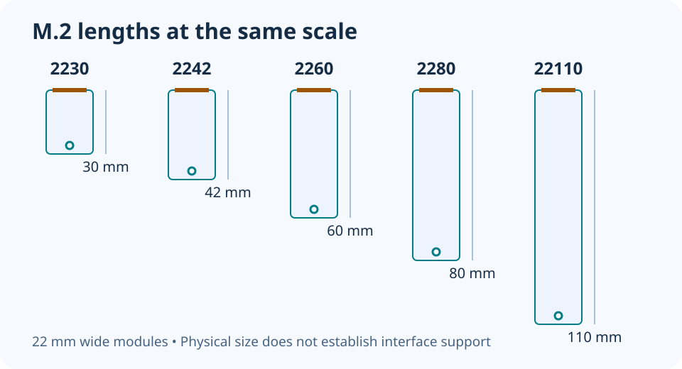

# M.2 SSD sizes: 2230, 2242, 2280 and 22110

**LE-12 · Unpublished research draft · No human editorial review**

Proposed byline: PC Part Performance; requires truthful attribution confirmation.

Intent: Decode M.2 length numbers and check the actual mounting position

Description: Use a same-scale length diagram to check the slot, mounting point, interface and heatsink envelope.

Research date: 2026-10-19. This is not a publication or modification date.

## Short answer

The digits describe physical dimensions: 2280 means 22 mm wide and 80 mm long. Length is one check; interface, keying, mounting and cooling space still have to match.

Original schematic; not a manufacturer wiring diagram, product measurement or benchmark.

## Decode the number before comparing drives

Kingston lists common SSD module sizes as 2230, 2242, 2260, 2280 and 22110: 22 mm wide with lengths of 30, 42, 60, 80 and 110 mm. The original same-scale diagram below compares those lengths without making claims about capacity or speed.

Do not read a longer module as automatically faster or more spacious. Controller, NAND, capacity and interface are separate specifications. Also distinguish the bare PCB dimensions from a product supplied with a heatsink; the installed envelope can be larger.

Applicable sources: [Kingston: SATA and M.2 SSD FAQs](https://www.kingston.com/en/ssd/ssd-faq).

## A supported length needs a supported mounting point

Find the exact M.2 socket in the motherboard or device manual. Record which lengths that socket supports and the correct standoff or latch position. A long cavity does not establish a usable mounting point for a shorter drive. Do not bend a module down to a misplaced standoff or improvise a screw arrangement.

Keep motherboard sockets distinct. One board can have several M.2 positions with different interfaces, lane sharing or physical restrictions. A Wi-Fi M.2 socket is not an SSD socket just because both names contain M.2. Check the exact socket specification rather than purchasing from the shape alone.

## Finish the interface and cooling checks

Verify SATA or PCIe/NVMe support and keying for the selected slot. Record any slot-sharing condition from the exact manual. Then inspect clearance for the device’s permitted single- or double-sided module and any required cooling assembly. Do not stack a factory heatsink underneath a board cover unless the manufacturers explicitly support it.

Before ordering, put the drive part number, length, selected slot and mounting hardware into the build notes. If the drive is replacing an existing system disk, plan the data migration separately. Correct dimensions do not prove boot support, preserve your files or establish the actual copy speed.

- Exact socket and supported lengths
- Correct standoff/latch position
- Supported interface and key
- Installed heatsink/side clearance
- Any lane-sharing condition

## Apply this to your PC

- [Choose storage and motherboard together](/builder/)
- [Inspect slot-sharing evidence](/compatibility/)

## Research evidence and limitations

### Kingston: SATA and M.2 SSD FAQs

[Original source](https://www.kingston.com/en/ssd/ssd-faq) · Inspected 2026-10-19

M.2 2230/2242/2260/2280/22110 correspond to 22 mm width and the encoded length; physical format alone does not establish interface compatibility.

Scope limitation: Old maximum-capacity examples on this page are deliberately not repeated as current limits.

Citation and original explanation only; no source images, diagrams or benchmark tables reproduced.

## Editorial decision still required

Research and draft preparation assisted by AI; no human editorial review or hands-on testing claimed.

Human review: not performed. Publication approval: not granted. No public Article schema, feed, sitemap or blog entry is authorized by this file.

Check the source-linked claims, diagram, safety conditions, search-intent fit and all internal links before deciding. A person must record a truthful complete-article review and byline; automated tests are not that review.

Content fingerprint: `a435719b258c4d2c5d033f2a7edc74cfda802767cd0db7a8047a2098d5c5c6bf`
