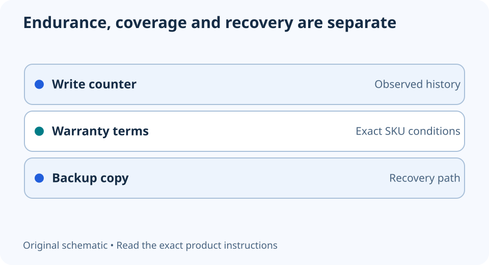

# SSD TBW: an endurance rating is not a failure countdown

**LE-13 · Unpublished research draft · No human editorial review**

Proposed byline: PC Part Performance; requires truthful attribution confirmation.

Intent: Interpret TBW, warranty limits and actual writes without predicting a drive failure date

Description: Read exact-capacity warranty terms and write observations without turning TBW into a promised lifespan.

Research date: 2026-10-19. This is not a publication or modification date.

## Short answer

TBW is a documented write-endurance measure used in some warranty conditions. It is not a clock that predicts the day an SSD will fail, and a warranty is not a backup.

Original schematic; not a manufacturer wiring diagram, product measurement or benchmark.

## Read the exact model and capacity terms

Samsung’s warranty resource separates model/capacity conditions, elapsed time and written-data limits. Read the entry for the exact drive rather than borrowing a figure from a larger capacity in the same family. A warranty duration and TBW condition must be considered together.

Do not convert the warranty limit into a guarantee that a drive cannot fail earlier, or a claim that it must fail immediately afterward. Warranty remedies, exclusions and data responsibilities are separate terms. This guide does not establish local statutory rights or promise data recovery.

Applicable sources: [Samsung: SSD product warranty](https://semiconductor.samsung.com/consumer-storage/support/warranty/).

## Use a write log for planning, not fortune-telling

If the vendor’s supported tool exposes total host writes, record the value, unit, tool version and date. Take another observation after a representative period. Preserve both raw values so that a GB/TB conversion or counter reset is not mistaken for a change in workload.

A calculated daily write average describes that interval only. A video-editing project, backup job or cache policy can change it substantially. Do not multiply one busy day into a promised multi-year lifespan. If the tool reports health warnings, back up and follow the vendor’s support path instead of trusting a reassuring remaining-percentage graphic.

## Compare drives around the workload and recovery plan

For a write-heavy purchase, compare the exact endurance terms alongside interface support, usable capacity and the application’s real storage behavior. A larger TBW number does not prove faster random access or better game FPS. Keep the warranty claim and the performance claim in separate columns.

Maintain a tested backup regardless of the rating. Store the invoice, part number and serial privately for support; share only the information needed to identify the public product. If your data matters more than the device, prioritize recovery planning before replacing a drive solely because its counter looks old.

Three different records

| Record | What it can tell you |
| --- | --- |
| Warranty/TBW condition | Documented coverage conditions for an exact SKU |
| Observed writes | What the counter recorded during a named interval |
| Backup test | Whether your recovery procedure works; not SSD health |

## Apply this to your PC

- [Record the exact SSD](/builder/)
- [Plan capacity separately](/tools/storage-capacity-planner/)

## Research evidence and limitations

### Samsung: SSD product warranty

[Original source](https://semiconductor.samsung.com/consumer-storage/support/warranty/) · Inspected 2026-10-19

Limited warranty conditions depend on exact model/capacity, elapsed time and total bytes written; warranty terms and exclusions must be read together.

Scope limitation: No promised drive failure date or data-recovery entitlement; no country-specific legal conclusion.

Citation and original explanation only; no source images, diagrams or benchmark tables reproduced.

## Editorial decision still required

Research and draft preparation assisted by AI; no human editorial review or hands-on testing claimed.

Human review: not performed. Publication approval: not granted. No public Article schema, feed, sitemap or blog entry is authorized by this file.

Check the source-linked claims, diagram, safety conditions, search-intent fit and all internal links before deciding. A person must record a truthful complete-article review and byline; automated tests are not that review.

Content fingerprint: `b30378acf2830891d5a324c0a4b7965e4c13b45a894a8042f10e1f519c5746ca`
