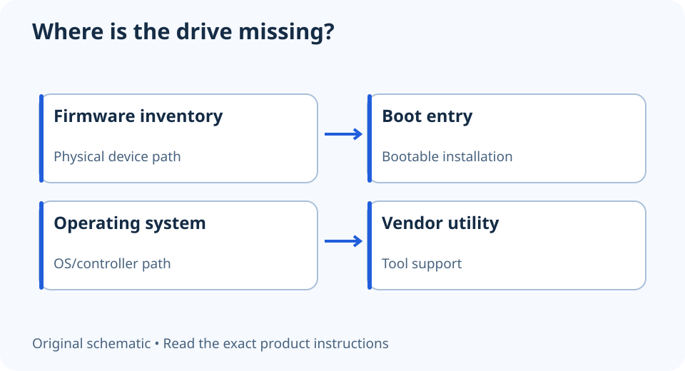

# SSD not showing in BIOS? Separate detection from booting

**LE-14 · Unpublished research draft · No human editorial review**

Proposed byline: PC Part Performance; requires truthful attribution confirmation.

Intent: Distinguish physical SSD detection from boot-entry and operating-system visibility problems

Description: A safe diagnostic sequence for a missing SSD, controller visibility and an absent boot entry.

Research date: 2026-10-19. This is not a publication or modification date.

## Short answer

First establish where the drive is missing: firmware device inventory, boot menu, operating system or a vendor utility. Those are different observations and do not justify the same repair.

Original schematic; not a manufacturer wiring diagram, product measurement or benchmark.

## Write down the actual symptom

“Not in BIOS” can mean the drive is absent from a storage list or simply absent from the boot menu. A detected blank SSD need not contain a bootable operating system. Photograph the relevant screen and record the drive part number, socket or SATA port and any recent hardware changes.

Samsung’s troubleshooting guidance covers connection, system support and detection limitations. It also notes that vendor-tool visibility can differ behind controllers such as RAID. A drive missing from Magician is therefore not, by itself, proof that the firmware cannot detect it.

Applicable sources: [Samsung: Internal SSD troubleshooting](https://semiconductor.samsung.com/consumer-storage/support/faqs/internalssd-trouble-shooting/).

## Check the documented path with power disconnected

Follow the exact device’s safety and handling instructions before reseating anything. For SATA, identify the data and power paths. For M.2, verify the supported interface, mounting and selected socket. Consult the motherboard’s storage and sharing notes instead of moving hardware repeatedly without a record.

If a previously working drive disappears, preserve that history. Stop experimentation when the drive contains important unbacked-up data or shows physical damage. Repeated repair attempts can complicate recovery; obtain appropriate support rather than treating every missing drive as a blank installation target.

## Avoid destructive fixes for an identification problem

Do not initialize, format or erase a drive just to make it visible in a list. Do not switch SATA/RAID modes blindly; a mode change can alter the path the installed operating system expects. A firmware update is also a separate, model-specific procedure with its own prerequisites.

Once the device is identified, address boot configuration or operating-system setup using the relevant official instructions. Keep detection, bootability and data accessibility as separate outcomes. A useful support report includes the exact SSD, board, firmware, connection and screenshots—not just “NVMe broken.”

- Location of missing-drive symptom recorded
- Exact drive and socket interface checked
- Connection inspected under manual precautions
- Data value and backup status assessed
- No initialization or mode switch used as a guess

## Apply this to your PC

- [Record the storage arrangement](/builder/)
- [Review the first-boot path](/build-school/)

## Research evidence and limitations

### Samsung: Internal SSD troubleshooting

[Original source](https://semiconductor.samsung.com/consumer-storage/support/faqs/internalssd-trouble-shooting/) · Inspected 2026-10-19

Check detection/connection and system firmware support; Samsung Magician detection can differ with controllers such as RAID.

Scope limitation: Does not authorize destructive initialization, universal BIOS-mode changes or a flash/update without the device’s instructions.

Citation and original explanation only; no source images, diagrams or benchmark tables reproduced.

## Editorial decision still required

Research and draft preparation assisted by AI; no human editorial review or hands-on testing claimed.

Human review: not performed. Publication approval: not granted. No public Article schema, feed, sitemap or blog entry is authorized by this file.

Check the source-linked claims, diagram, safety conditions, search-intent fit and all internal links before deciding. A person must record a truthful complete-article review and byline; automated tests are not that review.

Content fingerprint: `75cc82ce75c6760eeffa847f952b7c40ba9bf091f4ea68b971bf4ed1ea611405`
