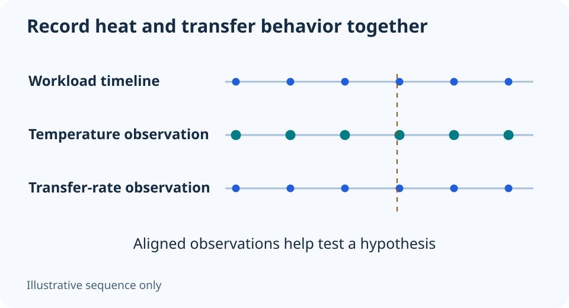

# Is your SSD thermal-throttling? Check more than one speed drop

**LE-15 · Unpublished research draft · No human editorial review**

Proposed byline: PC Part Performance; requires truthful attribution confirmation.

Intent: Investigate a suspected SSD heat slowdown without diagnosing it from throughput alone

Description: Separate heat-related slowdown from cache, workload and connection limits with a repeatable observation record.

Research date: 2026-10-19. This is not a publication or modification date.

## Short answer

Thermal throttling can reduce SSD performance during sustained work, but a falling transfer rate does not prove it. Record temperature, workload and timing together before changing cooling.

Original schematic; not a manufacturer wiring diagram, product measurement or benchmark.

## A speed graph is a symptom, not a diagnosis

Kingston describes how heat can trigger thermal throttling under sustained NVMe work and how airflow or a suitable heatsink can affect operating conditions. That establishes a mechanism, not a universal temperature threshold or a promised cooling improvement for your drive.

A transfer also depends on the source, destination, file pattern, cache behavior and other activity. Record those conditions before attributing a dip to temperature. Do not compare a sustained write of many files with a short sequential read specification as though they measure the same thing.

Applicable sources: [Kingston: M.2 NVMe SSD cooling](https://www.kingston.com/en/blog/pc-performance/ssd-cooling-m2-nvme-heatsink).

## Create a useful observation record

Use the drive manufacturer’s supported monitoring tool where available. Record exact drive/firmware, installed cooling, ambient conditions, temperature sensor name and the workload. Save the original result before altering the heatsink or case. If the task writes substantial data, ensure the test is justified and the files are backed up.

Observe whether the slowdown and temperature behavior recur under the same conditions. A sensor threshold needs the exact model’s documentation; do not copy another SSD’s limit. A simultaneous change can support further investigation, but it still does not rule out every other bottleneck.

## Inspect cooling without improvising it

Check the installation instructions for the SSD and motherboard cooling assembly. Confirm the correct pad arrangement and protective-film removal where specified. Do not stack incompatible heatsinks, remove labels or choose thermal-pad thickness from a random example. A larger metal cover is not proof of proper contact.

After a documented change, repeat the same observation and keep both results. If errors, disconnects or health warnings appear, prioritize backup and manufacturer support. The illustrative graph here teaches how to record a sequence; it contains no measured drive data and cannot establish a guaranteed benefit from any heatsink.

Keep these conditions with the result

| Field | Why it matters |
| --- | --- |
| Workload and duration | Short bursts and sustained transfers differ |
| Sensor and temperature | Names and thresholds differ by model |
| Cooling configuration | Contact and airflow are part of the setup |
| Other activity | The drive may not be the limiting device |

## Apply this to your PC

- [Record SSD and cooling choices](/builder/)
- [Understand copy-speed limits](/blog/ssd-transfer-time-advertised-speed/)

## Research evidence and limitations

### Kingston: M.2 NVMe SSD cooling

[Original source](https://www.kingston.com/en/blog/pc-performance/ssd-cooling-m2-nvme-heatsink) · Inspected 2026-10-19

Sustained work and heat can cause thermal throttling; airflow and correctly installed cooling affect operating conditions.

Scope limitation: No universal threshold, percentage slowdown or test result imported. A speed drop alone is not proof of heat throttling.

Citation and original explanation only; no source images, diagrams or benchmark tables reproduced.

## Editorial decision still required

Research and draft preparation assisted by AI; no human editorial review or hands-on testing claimed.

Human review: not performed. Publication approval: not granted. No public Article schema, feed, sitemap or blog entry is authorized by this file.

Check the source-linked claims, diagram, safety conditions, search-intent fit and all internal links before deciding. A person must record a truthful complete-article review and byline; automated tests are not that review.

Content fingerprint: `b12dd8fe8c0fdbd3bf3558dfcb0e02b2459e65f75cd550be7cc44055fe94b491`
