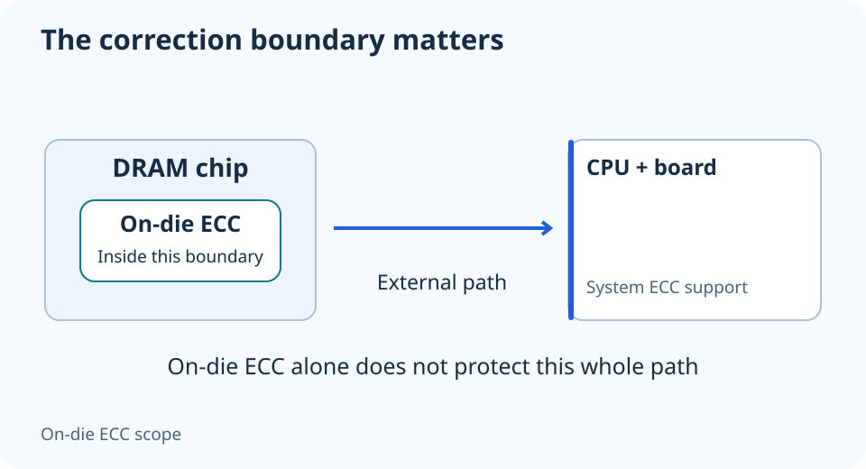

# DDR5 on-die ECC is not the same as system ECC

**LE-16 · Unpublished research draft · No human editorial review**

Proposed byline: PC Part Performance; requires truthful attribution confirmation.

Intent: Prevent on-die ECC or an ECC label from being mistaken for complete platform support

Description: Separate internal DRAM correction, ECC UDIMMs and registered memory before shopping for workstation RAM.

Research date: 2026-10-19. This is not a publication or modification date.

## Short answer

DDR5’s on-die ECC corrects errors inside a DRAM chip. It does not make every DDR5 desktop module an end-to-end ECC memory system or make registered memory compatible with an ordinary desktop.

Original schematic; not a manufacturer wiring diagram, product measurement or benchmark.

## Ask where correction operates

Kingston explains that on-die ECC does not correct errors on the bus between the module and memory controller. System-level ECC needs the relevant memory type and platform support. These are different scopes of protection, so “DDR5 has ECC” is an incomplete buying answer.

The schematic below shows the boundary deliberately: correction inside a chip is not a protected path all the way to the CPU. It does not claim that any implementation prevents every corruption or replaces backups, application checks or a recovery plan.

Applicable sources: [Kingston: DDR5 memory standard overview](https://www.kingston.com/en/blog/pc-performance/ddr5-overview).

## Module type is a separate compatibility field

Read UDIMM, ECC UDIMM and RDIMM as distinct identities. A server-memory listing is not a bargain substitute merely because it has the same DDR generation and attractive capacity. Check the processor, board and firmware support for the exact type and kit.

AMD’s Ryzen 9 9950X, for example, specifies DDR5 UDIMM and says ECC support requires motherboard support. That conditional statement is not support for arbitrary registered server memory. Do not copy one CPU’s ECC field into an approval for another processor or for a motherboard that lacks the necessary implementation.

Applicable sources: [AMD: Ryzen 9 9950X specifications](https://www.amd.com/en/products/processors/desktops/ryzen/9000-series/amd-ryzen-9-9950x.html).

## Document a complete evidence chain

For a workstation purchase, record the module part number and type, CPU support, motherboard support and any firmware condition. If the operating system exposes an ECC status, keep the actual verification method with the record; a product-box claim does not prove the installed correction path is active.

Choose memory around the workload’s reliability requirements and the supported platform. This guide does not measure error rates or claim a gaming advantage. If the seller’s description conflicts with the part-number datasheet, resolve the identity before ordering rather than using the most reassuring label.

- On-die and system-level claims separated
- Exact module type identified
- CPU and motherboard support both documented
- Installed verification method recorded
- Backup strategy remains separate

## Apply this to your PC

- [Compare exact platform specifications](/compare/)
- [Record your workstation parts](/builder/)

## Research evidence and limitations

### Kingston: DDR5 memory standard overview

[Original source](https://www.kingston.com/en/blog/pc-performance/ddr5-overview) · Inspected 2026-10-19

DDR5 on-die ECC works inside DRAM and does not protect the external bus; system ECC requires appropriate module, CPU and platform support; UDIMM and RDIMM are different module types.

Scope limitation: On-die correction is not end-to-end ECC or a guarantee against all data corruption.

Citation and original explanation only; no source images, diagrams or benchmark tables reproduced.

### AMD: Ryzen 9 9950X specifications

[Original source](https://www.amd.com/en/products/processors/desktops/ryzen/9000-series/amd-ryzen-9-9950x.html) · Inspected 2026-10-19

Two memory channels, DDR5 UDIMM; 2×1R/2×2R DDR5-5600 versus 4×1R/4×2R DDR5-3600 maximum-memory-speed entries; ECC requires board support.

Scope limitation: One exact CPU. Rank is not synonymous with a module’s capacity or with a channel. Not overclocking results or a universal rule for all Ryzen models.

Citation and original explanation only; no source images, diagrams or benchmark tables reproduced.

## Editorial decision still required

Research and draft preparation assisted by AI; no human editorial review or hands-on testing claimed.

Human review: not performed. Publication approval: not granted. No public Article schema, feed, sitemap or blog entry is authorized by this file.

Check the source-linked claims, diagram, safety conditions, search-intent fit and all internal links before deciding. A person must record a truthful complete-article review and byline; automated tests are not that review.

Content fingerprint: `c6c10659dff4e6ff7696249e70276ac1dc11e7fdcb480a4fc43fee1ac01f452a`
