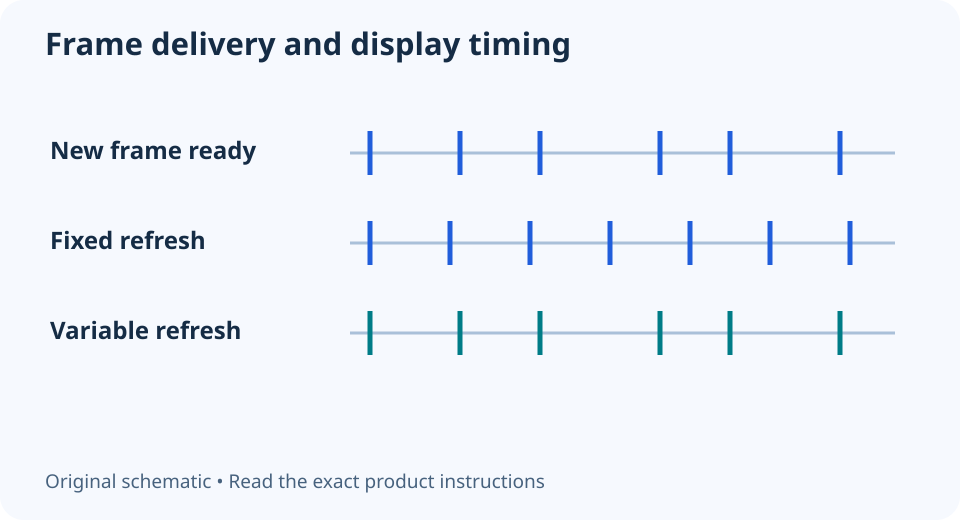

# FreeSync, G-SYNC Compatible and VRR: check the whole path

**LE-17 · Unpublished research draft · No human editorial review**

Proposed byline: PC Part Performance; requires truthful attribution confirmation.

Intent: Identify a supported variable-refresh path for the exact GPU and display input

Description: Match GPU, display input, cable and settings instead of treating a variable-refresh badge as a universal promise.

Research date: 2026-10-19. This is not a publication or modification date.

## Short answer

Variable refresh changes when a display refreshes to follow frame delivery within its supported behavior. It does not create more game frames or guarantee that every kind of stutter disappears.

Original schematic; not a manufacturer wiring diagram, product measurement or benchmark.

## Certification and operation answer different questions

AMD FreeSync and NVIDIA G-SYNC Compatible describe vendor programs built around variable-refresh displays. NVIDIA says its Compatible label identifies a VRR display it has validated. That is different from assuming any monitor with a vaguely similar feature name works identically over every input.

Read the exact display model’s supported range and inputs alongside the GPU’s requirements. HDMI and DisplayPort can have different restrictions on the same monitor. Preserve those differences rather than reducing the purchase to a badge or an unspecified maximum refresh number.

Applicable sources: [NVIDIA: G-SYNC control-panel help](https://www.nvidia.com/content/Control-Panel-Help/vLatest/en-us/mergedProjects/Display/Variable_Refresh_Rate.htm); [AMD: FreeSync technology](https://www.amd.com/en/products/graphics/technologies/freesync.html).

## Trace the connection and settings

List the GPU output, cable or adapter, display input and required settings at both ends. Check the display’s on-screen menu and the supported driver control panel. A cable connected to a different port, or a dock with different capabilities, changes the path you are evaluating.

Do not treat a successful high-refresh signal as proof that variable refresh is active. Use the monitor and driver’s supported indicators or test procedure. Record the operating mode you checked, including window/full-screen behavior where relevant, so later troubleshooting is not based on an assumed setting.

## Keep rendering performance separate

A game can still deliver uneven work because of shader compilation, CPU stalls or another problem. VRR addresses display timing; it is not a diagnosis for all of those mechanisms. Evaluate game performance with matching settings and evidence rather than expecting the display feature to repair the renderer.

Before buying, compare the complete supported path and your intended games. Leave an undocumented range or adapter behavior unresolved. The animation proposed by this guide is a timing explanation only: it does not reproduce a monitor measurement, quantify input latency or establish that one certification is always the better purchase.

- Exact monitor and GPU
- Supported input and range
- Cable/adapter capability
- Display and driver settings
- Observed active mode recorded

## Apply this to your PC

- [Compare display and GPU choices](/compare/)
- [Inspect game evidence separately](/performance/)

## Research evidence and limitations

### NVIDIA: G-SYNC control-panel help

[Original source](https://www.nvidia.com/content/Control-Panel-Help/vLatest/en-us/mergedProjects/Display/Variable_Refresh_Rate.htm) · Inspected 2026-10-19

G-SYNC aligns display refresh with GPU frame output; G-SYNC Compatible is NVIDIA validation of a VRR display.

Scope limitation: Legacy OS examples are not adopted as current recommendations. Actual monitor/input/GPU support still governs.

Citation and original explanation only; no source images, diagrams or benchmark tables reproduced.

### AMD: FreeSync technology

[Original source](https://www.amd.com/en/products/graphics/technologies/freesync.html) · Inspected 2026-10-19

FreeSync uses variable-refresh protocols and a certification program; features depend on display and connection.

Scope limitation: Marketing claims do not prove all stutter disappears. Tier requirements can change; no copied tier table or universal range.

Citation and original explanation only; no source images, diagrams or benchmark tables reproduced.

## Editorial decision still required

Research and draft preparation assisted by AI; no human editorial review or hands-on testing claimed.

Human review: not performed. Publication approval: not granted. No public Article schema, feed, sitemap or blog entry is authorized by this file.

Check the source-linked claims, diagram, safety conditions, search-intent fit and all internal links before deciding. A person must record a truthful complete-article review and byline; automated tests are not that review.

Content fingerprint: `360ab69cd4923e3925f19c63c2e50fa87a0d7913a05adc40307bf3f0a03025e3`
