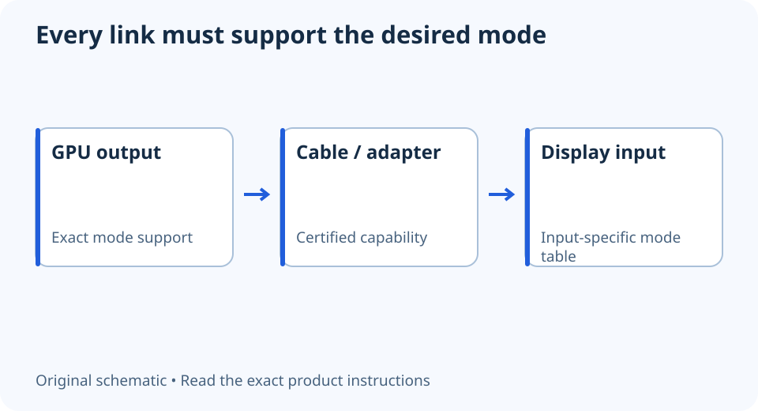

# DisplayPort or HDMI for 1440p high refresh? Read the mode table

**LE-18 · Unpublished research draft · No human editorial review**

Proposed byline: PC Part Performance; requires truthful attribution confirmation.

Intent: Choose a supported 1440p high-refresh connection from exact monitor and GPU specifications

Description: Check exact device modes, bit depth, compression and cable certification instead of buying from a connector-version slogan.

Research date: 2026-10-19. This is not a publication or modification date.

## Short answer

Use the connection that both devices support for your exact resolution, refresh rate and colour mode. The HDMI or DisplayPort shape alone does not establish that mode.

Original schematic; not a manufacturer wiring diagram, product measurement or benchmark.

## Write the desired mode completely

“1440p” leaves important questions unanswered. Record resolution, refresh rate, colour depth, HDR requirements and any compression condition. Then look for that mode in the monitor’s documentation and the GPU output specification. A mode available on one input may differ on another.

HDMI’s current specification overview and VESA’s cable guidance make the complete link relevant. Do not assume a version label supplies every feature, or that an old cable article covers all newer modes. Read the devices’ current mode tables rather than calculating a universal limit from the socket.

Applicable sources: [HDMI Licensing Administrator: HDMI 2.2 specification overview](https://www.hdmi.org/spec/hdmi2); [VESA/DisplayPort: Choosing a DisplayPort cable](https://www.displayport.org/how-to-choose-a-displayport-cable-and-not-get-a-bad-one/).

## Treat adapters and docks as links in the chain

If an adapter, dock or extension is involved, identify its exact supported conversion and limits. A cable’s two connector shapes do not prove a direction of conversion or support for VRR, HDR or the desired refresh rate. Prefer a simpler documented path when it solves the actual use case.

Check an appropriate cable certification and manufacturer listing for the needed capability. Do not use vague “gaming cable” wording as evidence. Save the cable model with the device mode you intend to run so a later replacement can be evaluated against a requirement rather than a marketing name.

## Verify the negotiated mode after connecting

Inspect the operating system’s advanced display information and the monitor’s own information screen. Confirm the selected refresh, resolution and colour settings instead of assuming the maximum advertised on the box became active. If a desired mode is unavailable, recheck the input and link before replacing the GPU.

A supported signal mode is not measured game FPS. Keep rendering evidence separate, and do not interpret an interface bandwidth headline as end-to-end latency. This checklist is useful even when the final answer is to keep an existing cable: the aim is a documented working mode, not purchasing the newest connector revision.

A complete display-mode requirement

| Field | Record |
| --- | --- |
| Image | Resolution and refresh |
| Colour | Bit depth and HDR requirement |
| Link | Output, cable/adapter and input |
| Conditions | Compression or input-specific limitations |
| Verification | Actual negotiated mode after setup |

## Apply this to your PC

- [Compare display specifications](/compare/)
- [Keep FPS separate from refresh](/performance/)

## Research evidence and limitations

### HDMI Licensing Administrator: HDMI 2.2 specification overview

[Original source](https://www.hdmi.org/spec/hdmi2) · Inspected 2026-10-19

Current HDMI feature and cable discussion separates features and supported capabilities; VRR and display-stream compression are relevant to a complete link.

Scope limitation: No assumption that a version label provides every optional feature or maximum rate; this is not the complete licensed specification.

Citation and original explanation only; no source images, diagrams or benchmark tables reproduced.

### VESA/DisplayPort: Choosing a DisplayPort cable

[Original source](https://www.displayport.org/how-to-choose-a-displayport-cable-and-not-get-a-bad-one/) · Inspected 2026-10-19

Certified cables have defined capability; required source/display features and link bandwidth matter.

Scope limitation: Historical cable examples are not asserted to cover all 2026 modes. No universal refresh limit derived from the connector shape.

Citation and original explanation only; no source images, diagrams or benchmark tables reproduced.

## Editorial decision still required

Research and draft preparation assisted by AI; no human editorial review or hands-on testing claimed.

Human review: not performed. Publication approval: not granted. No public Article schema, feed, sitemap or blog entry is authorized by this file.

Check the source-linked claims, diagram, safety conditions, search-intent fit and all internal links before deciding. A person must record a truthful complete-article review and byline; automated tests are not that review.

Content fingerprint: `48dc32d8b273ad6b3679a7c2e5a34b6d2a08cf64e51774df7233713fd9a76fdf`
