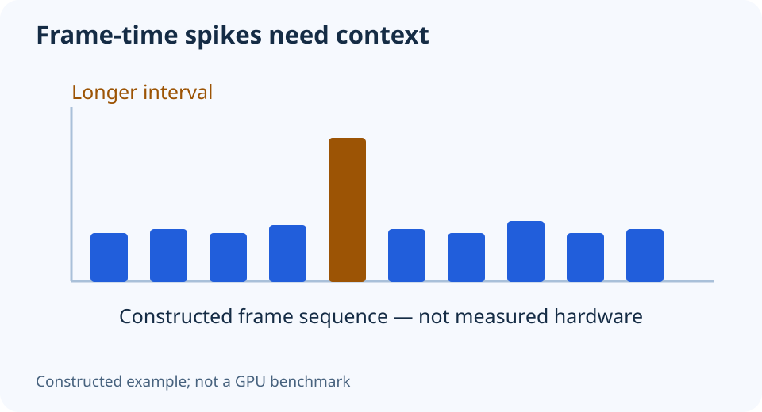

# Record game frame times: a repeatable capture worksheet

**LE-19 · Unpublished research draft · No human editorial review**

Proposed byline: PC Part Performance; requires truthful attribution confirmation.

Intent: Create a reproducible personal frame-time capture without claiming a universal benchmark

Description: Plan a comparable PresentMon capture with settings, scene, tool version and metric limitations recorded.

Research date: 2026-10-19. This is not a publication or modification date.

## Short answer

A useful capture needs a repeatable scene and a complete settings record. A frame-time file without its context cannot establish why one PC, driver or setting performed differently.

Original schematic; not a manufacturer wiring diagram, product measurement or benchmark.

## Choose the question before recording

Decide what you are comparing: a settings change, an upgrade or an intermittent hitch. Choose a repeatable route or built-in sequence and define what is excluded, such as loading screens. Record game version, resolution, quality settings, upscaling, frame generation, CPU/GPU and driver.

PresentMon’s official project describes Windows capture tools that use presentation events and can export per-frame data. It also documents metric limitations. Use the current official release and documentation; do not assume every similarly named overlay measures the same point in the pipeline.

Applicable sources: [Intel/GameTechDev: PresentMon documentation](https://github.com/GameTechDev/PresentMon).

## Preserve comparable runs

Keep the same scene, duration and background conditions for the comparison. Record whether the run is a first launch or follows a warm-up. Keep multiple raw captures when practical so a single unusual run does not become the entire conclusion. Do not delete slow frames merely because they make a graph look untidy.

Write down the capture tool’s version and selected metric. Presented-frame timing, display timing and input latency are different measurements. Frame generation introduces another distinction; identify whether a reported rate includes generated output before comparing it with native rendering.

Applicable sources: [Intel/GameTechDev: PresentMon documentation](https://github.com/GameTechDev/PresentMon).

## Explain the chart before choosing a part

A frame-time spike means a frame interval was longer in the recorded metric. It does not identify the responsible component by itself. Use the timing and repeatability to guide a follow-up, and inspect the source context before turning the result into a purchase recommendation.

The original chart here contains constructed teaching values, not a tested GPU result. If you later publish your own capture, include the conditions and calculation definition with the raw evidence you are entitled to share. Do not turn one personal run into a claim that every system with the same GPU will achieve the same FPS.

- Question and repeatable scene
- Hardware, game/driver versions and settings
- Capture version and exact metric
- Raw runs retained
- Generated versus native output identified
- No component blame from one spike alone

## Apply this to your PC

- [Inspect the site’s performance evidence](/performance/)
- [Record the tested configuration](/builder/)

## Research evidence and limitations

### Intel/GameTechDev: PresentMon documentation

[Original source](https://github.com/GameTechDev/PresentMon) · Inspected 2026-10-19

Windows ETW-based capture produces frame duration/latency records; capture, service and console tools have documented metric limitations.

Scope limitation: No site-owned benchmark was run; illustrative frame-time values are constructed examples, not submitted measurements.

Citation and original explanation only; no source images, diagrams or benchmark tables reproduced.

## Editorial decision still required

Research and draft preparation assisted by AI; no human editorial review or hands-on testing claimed.

Human review: not performed. Publication approval: not granted. No public Article schema, feed, sitemap or blog entry is authorized by this file.

Check the source-linked claims, diagram, safety conditions, search-intent fit and all internal links before deciding. A person must record a truthful complete-article review and byline; automated tests are not that review.

Content fingerprint: `56f52ab4d21305dc8a033b77456a877305dd7e304d89cba4b7f79a30eae32616`
