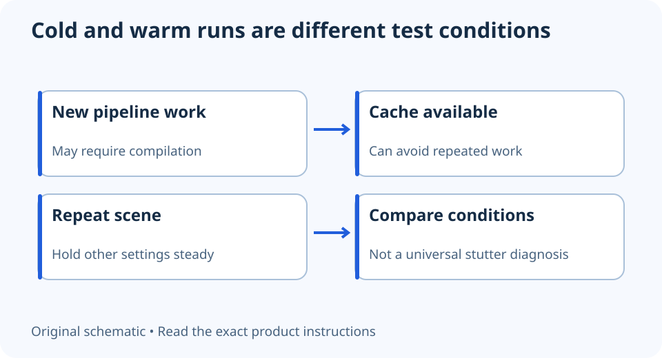

# First-run stutter: why shader-cache state belongs in the test notes

**LE-20 · Unpublished research draft · No human editorial review**

Proposed byline: PC Part Performance; requires truthful attribution confirmation.

Intent: Recognize shader-cache state as a testing condition without diagnosing every hitch as compilation

Description: Separate cold and warm runs and preserve evidence before clearing caches or blaming storage.

Research date: 2026-10-19. This is not a publication or modification date.

## Short answer

A game’s first run and a later run can do different work. Record cache and launch conditions before comparing them, and do not clear caches as a universal stutter fix.

Original schematic; not a manufacturer wiring diagram, product measurement or benchmark.

## Compilation and rendering are different stages

AMD GPUOpen documents a driver-side stage that compiles pipeline information for a particular GPU, and explains that caching can avoid repeating some work. A cold-cache run can therefore differ from a later run. That is a mechanism to investigate, not proof of the cause of a particular game’s hitch.

The developer documentation describes experiments for diagnosis. It is not a consumer instruction to disable caches, delete folders or import someone else’s cache. Avoid turning a developer switch into a generic optimization tip.

Applicable sources: [AMD GPUOpen: Radeon Developer Panel system experiments](https://gpuopen.com/manuals/rdp_manual/system/).

## Preserve the state you are trying to understand

Record whether the issue began after a game or driver update, happens only at a new location, or recurs on a repeated route. Keep the same quality settings and capture conditions. Note whether an official in-game compilation step finished before the run.

Do not repeatedly erase caches between observations unless your question specifically requires a documented cold-state test and you understand the product instructions. Otherwise, you can recreate first-run work and mistake the resulting slowdown for a persistent hardware limit.

## Compare explanations instead of jumping to an upgrade

If a second pass becomes smoother, that observation supports further investigation but does not identify compilation uniquely. Asset loading, background work and other changing conditions can differ too. Use repeatable frame-time capture and official game support notes to narrow the question.

If the problem repeats, record its location and conditions and report it through the game’s real support route. Do not buy a faster SSD or CPU from a single spike, and do not install untrusted cache packages. A useful result can be “cause still unresolved” with a precise reproducible sequence; it is more actionable than an unsupported bottleneck percentage.

Keep these runs distinct

| Run state | Record |
| --- | --- |
| First launch after change | Game/driver versions and compilation state |
| Repeated route | Same settings, scene and capture duration |
| Persistent hitch | Exact location, repeatability and other observations |

## Apply this to your PC

- [Use evidence-led game performance](/performance/)
- [Plan an upgrade after diagnosis](/upgrade/)

## Research evidence and limitations

### AMD GPUOpen: Radeon Developer Panel system experiments

[Original source](https://gpuopen.com/manuals/rdp_manual/system/) · Inspected 2026-10-19

Driver-side pipeline compilation can take time; compiled shaders may be cached; cold-cache and warm-cache runs differ.

Scope limitation: Developer diagnostics are not consumer instructions to disable caches or clear folders; a correlation does not diagnose every hitch.

Citation and original explanation only; no source images, diagrams or benchmark tables reproduced.

## Editorial decision still required

Research and draft preparation assisted by AI; no human editorial review or hands-on testing claimed.

Human review: not performed. Publication approval: not granted. No public Article schema, feed, sitemap or blog entry is authorized by this file.

Check the source-linked claims, diagram, safety conditions, search-intent fit and all internal links before deciding. A person must record a truthful complete-article review and byline; automated tests are not that review.

Content fingerprint: `8e889ea2a8c4a5616f2d66b125bce5bbe38c2f82829373491b7b9f2a4fd58bf2`
