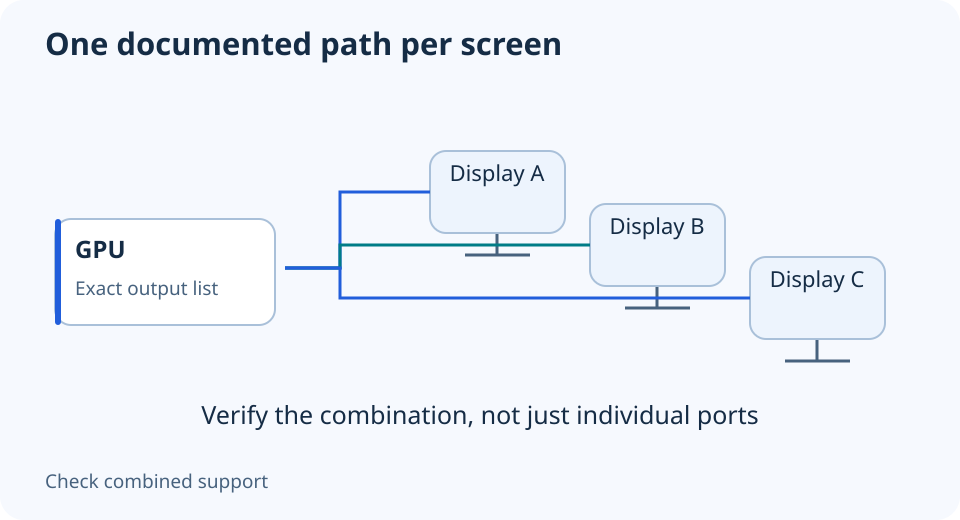

# Choosing a GPU for two or three monitors: map the outputs

**LE-21 · Unpublished research draft · No human editorial review**

Proposed byline: PC Part Performance; requires truthful attribution confirmation.

Intent: Verify a multi-monitor connection plan for exact displays and GPU outputs

Description: Plan connectors, simultaneous modes, adapters and rendering workload without assuming all port maximums combine.

Research date: 2026-10-19. This is not a publication or modification date.

## Short answer

Count supported simultaneous displays and map each exact monitor mode to a real output. Four physical sockets do not prove every maximum resolution and refresh combination works at once.

Original schematic; not a manufacturer wiring diagram, product measurement or benchmark.

## Make a row for every display

Record monitor model, desired resolution and refresh, required input, HDR/VRR needs and cable. Mark which screen runs games and which shows desktop work. Separate this connection plan from the rendering workload; driving a desktop screen is not the same question as rendering a game across all screens.

NVIDIA’s RTX 5070 family specification lists reference connections and up-to-four-display support with qualifications. That is not a universal simultaneous maximum-mode promise. Confirm the exact partner card’s ports and read the applicable display-support footnotes before ordering.

Applicable sources: [NVIDIA: GeForce RTX 5070 family specifications](https://www.nvidia.com/en-us/geforce/graphics-cards/50-series/rtx-5070-family/).

## Treat each adapter as a specified part

Map a specific output to each monitor input. If a dock, daisy chain or adapter is involved, document its direction, supported modes and limits. A spare connector does not prove the adapter can provide the desired refresh or preserve a variable-refresh feature.

Use the manufacturers’ supported combinations rather than adding individual maximum bandwidth headlines together. If the documentation does not cover your exact combination, ask the vendor and keep it unresolved. Do not advertise an untested multi-screen setup as a verified property of the GPU chip.

## Verify the final desktop arrangement

After connecting, confirm each negotiated resolution and refresh in the operating system and display information screens. Verify the intended extended or mirrored arrangement and your main gaming display. Keep those observations with the cable map for future troubleshooting.

If gaming across multiple screens, find evidence for that actual rendered resolution and settings. Do not multiply a single-monitor FPS estimate by the number of displays, or infer gaming performance from maximum desktop resolution. A complete output map can justify keeping a current card if it already supports the task.

Fill one row per monitor

| Display | Mode | Path | Verification |
| --- | --- | --- | --- |
| Monitor A | Resolution + Hz | GPU port → cable → input | Actual negotiated mode |
| Monitor B | Resolution + Hz | GPU port → cable → input | Actual negotiated mode |
| Monitor C | Resolution + Hz | GPU port → adapter if needed | Combination support still required |

## Apply this to your PC

- [Compare exact graphics-card outputs](/compare/)
- [Record the complete configuration](/builder/)

## Research evidence and limitations

### NVIDIA: GeForce RTX 5070 family specifications

[Original source](https://www.nvidia.com/en-us/geforce/graphics-cards/50-series/rtx-5070-family/) · Inspected 2026-10-19

Reference display connections and up-to-four-display support have qualifications; partner-card dimensions vary. GPU power-connector alternatives and installation-space requirements are model-specific.

Scope limitation: No simultaneous maximum-mode guarantee; no partner layout inferred from Founders Edition. No performance chart reused.

Citation and original explanation only; no source images, diagrams or benchmark tables reproduced.

## Editorial decision still required

Research and draft preparation assisted by AI; no human editorial review or hands-on testing claimed.

Human review: not performed. Publication approval: not granted. No public Article schema, feed, sitemap or blog entry is authorized by this file.

Check the source-linked claims, diagram, safety conditions, search-intent fit and all internal links before deciding. A person must record a truthful complete-article review and byline; automated tests are not that review.

Content fingerprint: `449ab053ed512f334eb55fc70acb2fb2a05b845b2be75fbd35a124cfdc0f97a5`
