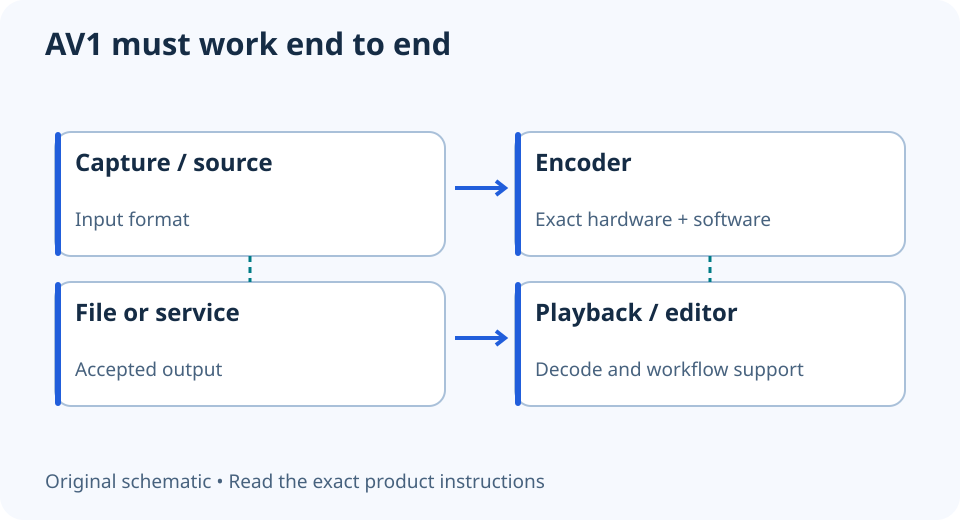

# AV1 encoding: check hardware, software and the destination

**LE-22 · Unpublished research draft · No human editorial review**

Proposed byline: PC Part Performance; requires truthful attribution confirmation.

Intent: Verify an AV1 recording or streaming path without assuming decode support implies encode support

Description: Distinguish AV1 playback from recording and verify the complete encode workflow before choosing a GPU.

Research date: 2026-10-19. This is not a publication or modification date.

## Short answer

AV1 decoding and AV1 encoding are separate capabilities. Check the exact GPU’s encoder, the application and the receiving service or editor before buying hardware for AV1.

Original schematic; not a manufacturer wiring diagram, product measurement or benchmark.

## Start with the direction of the work

Playback decodes compressed video; recording or export encodes it. NVIDIA’s support matrix separates these functions and specifies capabilities by GPU and format. A card that plays AV1 video is not automatically able to record it through an AV1 hardware encoder.

Do not reduce the question to a GPU generation. Record the exact model, codec, bit depth and relevant format, then inspect the matching matrix entry. The matrix is a capability resource, not a measured quality comparison or a promise of real-time throughput for every preset.

Applicable sources: [NVIDIA: Video encode and decode support matrix](https://developer.nvidia.com/video-encode-decode-support-matrix).

## Trace the application and destination

Confirm that your recording or streaming application exposes the supported encoder on the installed hardware and driver. OBS’s hardware-encoding guide is a useful official starting point for its supported workflow. A selectable encoder does not establish that a particular streaming service accepts that output.

For local recordings, check the editor and playback devices that will use the file. For live streaming, use the destination’s current format guidance. Keep container, audio and workflow requirements with the codec choice rather than assuming every part of the pipeline changes automatically.

Applicable sources: [OBS Project: Hardware encoding](https://obsproject.com/kb/hardware-encoding).

## Compare a real use case before replacing hardware

Make a small representative test recording with hardware you already own when possible. Inspect successful playback, editing and the application’s dropped-frame or overload reporting. Preserve the settings. Do not compare different presets or bitrates as though they were a controlled encoder-quality test.

If a new GPU is needed, include game-rendering demands, power connections, case fit and actual verified price separately. AV1 support may be a useful feature, but it does not choose an overall GPU winner or establish a free performance gain. This guide provides no encoder benchmark or claimed quality percentage.

- Encode versus decode identified
- Exact model and format supported
- Application/driver path verified
- Destination accepts the output
- Representative file tested

## Apply this to your PC

- [Compare GPU features](/compare/)
- [Plan a gaming/streaming system](/blog/gaming-streaming-pc-planning/)

## Research evidence and limitations

### NVIDIA: Video encode and decode support matrix

[Original source](https://developer.nvidia.com/video-encode-decode-support-matrix) · Inspected 2026-10-19

Encode and decode support are separate and vary by exact GPU, codec, bit depth and format.

Scope limitation: Citation only; no matrix republished and no real-time quality or FPS promises.

Citation and original explanation only; no source images, diagrams or benchmark tables reproduced.

### OBS Project: Hardware encoding

[Original source](https://obsproject.com/kb/hardware-encoding) · Inspected 2026-10-19

Available hardware encoders depend on hardware and software; selection belongs in the recording/streaming workflow.

Scope limitation: An encoder being selectable does not establish service acceptance, quality equivalence or zero performance cost.

Citation and original explanation only; no source images, diagrams or benchmark tables reproduced.

## Editorial decision still required

Research and draft preparation assisted by AI; no human editorial review or hands-on testing claimed.

Human review: not performed. Publication approval: not granted. No public Article schema, feed, sitemap or blog entry is authorized by this file.

Check the source-linked claims, diagram, safety conditions, search-intent fit and all internal links before deciding. A person must record a truthful complete-article review and byline; automated tests are not that review.

Content fingerprint: `317fe1274941cf2d49160dc4404883ab7ec586092adcedffdef78ebf760e699b`
