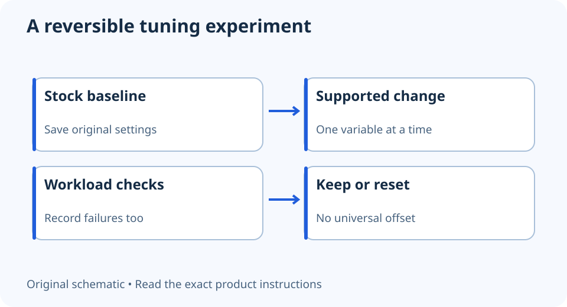

# GPU undervolting: preserve stock settings and validate the change

**LE-23 · Unpublished research draft · No human editorial review**

Proposed byline: PC Part Performance; requires truthful attribution confirmation.

Intent: Evaluate supported GPU undervolting as a reversible experiment with documented limitations

Description: A cautious decision guide for supported tuning, rollback, workloads and avoiding copied voltage settings.

Research date: 2026-10-19. This is not a publication or modification date.

## Short answer

Undervolting is an operating-setting change, not a guaranteed improvement. Use only the supported controls for the exact GPU, preserve stock behavior and verify the workload before relying on the result.

Original schematic; not a manufacturer wiring diagram, product measurement or benchmark.

## Check the supported tool and its scope

AMD’s Adrenalin tuning documentation describes an undervolt option for select GPUs, along with defaults, profiles and stress-test behavior. An option available on one card or driver is not a supported procedure for every graphics card. Read the software terms and product guidance before proceeding.

This guide supplies no voltage, clock offset or power-limit recipe. Two apparently identical cards can still need different operating settings. Do not flash modified firmware, disable protection or import an unknown profile to reproduce someone else’s screenshot.

Applicable sources: [AMD: Adrenalin GPU performance tuning](https://www.amd.com/en/resources/support-articles/faqs/DH3-020.html).

## Establish what the stock configuration does

Back up important work and record the exact GPU, driver, current settings and the workloads you care about. Preserve the default profile and the supported reset route. If the PC is already unstable at stock, investigate that first rather than tuning around an unidentified fault.

Define the objective before changing anything: a particular noise concern, power behavior or repeatable workload. Record the same observations before and after. A lower reported voltage alone does not prove a meaningful benefit, and a synthetic score alone does not represent every game or application.

## Treat validation as ongoing evidence

Use the vendor’s supported test process and representative real workloads. A short stress test passing is an observation, not a universal stability guarantee. Record artifacts, crashes, errors and changes in behavior. Avoid testing important unsaved work as the first workload.

If a problem appears, restore the supported default and verify it again. AMD documents automatic reset after certain stress-test failures, but automatic recovery is not a substitute for your own rollback record. Revisit the configuration after a driver or workload change. Do not publish a promised temperature, power or FPS reduction without an actual controlled measurement.

- Supported exact-model controls
- Stock baseline retained
- Objective and comparable workload
- No copied voltage prescription
- Rollback checked
- Result described as observed, not guaranteed

## Apply this to your PC

- [Record the tested GPU configuration](/my-pc/)
- [Check game evidence separately](/performance/)

## Research evidence and limitations

### AMD: Adrenalin GPU performance tuning

[Original source](https://www.amd.com/en/resources/support-articles/faqs/DH3-020.html) · Inspected 2026-10-19

Undervolt options are available only on select GPUs; reset/default and stress-test behavior are documented.

Scope limitation: No voltage offsets or stability guarantees copied. Automatic recovery is not a substitute for backups or confirmation of stock behavior.

Citation and original explanation only; no source images, diagrams or benchmark tables reproduced.

## Editorial decision still required

Research and draft preparation assisted by AI; no human editorial review or hands-on testing claimed.

Human review: not performed. Publication approval: not granted. No public Article schema, feed, sitemap or blog entry is authorized by this file.

Check the source-linked claims, diagram, safety conditions, search-intent fit and all internal links before deciding. A person must record a truthful complete-article review and byline; automated tests are not that review.

Content fingerprint: `b4ebeadd69c7ba321310142c3f046695b05ae6aafe50404062b98e5a6dafe993`
