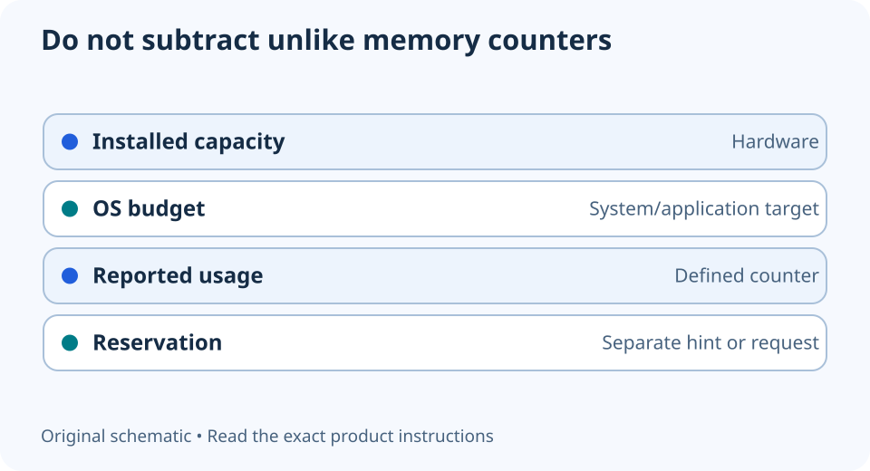

# VRAM capacity, usage and budget are different numbers

**LE-24 · Unpublished research draft · No human editorial review**

Proposed byline: PC Part Performance; requires truthful attribution confirmation.

Intent: Interpret different GPU-memory counters and avoid a false upgrade conclusion

Description: Read graphics-memory counters without turning one overlay value into a capacity requirement or FPS prediction.

Research date: 2026-10-19. This is not a publication or modification date.

## Short answer

Installed VRAM is a hardware capacity. An application’s usage, reservation and operating-system budget are different observations. Identify the counter before using it to decide that a GPU needs replacing.

Original schematic; not a manufacturer wiring diagram, product measurement or benchmark.

## Ask what the counter actually measures

Microsoft’s DXGI documentation separates the OS-provided Budget, CurrentUsage and CurrentReservation fields. It warns that an application exceeding its budget may incur performance penalties. The existence of these separate fields is why a label such as “memory used” needs a definition.

That API description does not identify what every game menu or overlay reports. Some values may describe a request or reservation rather than a direct measurement of every actively needed byte. Read the tool’s documentation and record the exact counter name, not merely a screenshot with a large number.

Applicable sources: [Microsoft: DXGI video-memory budget structure](https://learn.microsoft.com/en-us/windows/win32/api/dxgi1_4/ns-dxgi1_4-dxgi_query_video_memory_info).

## Use a controlled settings comparison

If investigating a memory-related symptom, record the exact scene, resolution, texture settings, other graphics options and background applications. Compare one supported setting change while keeping the rest fixed. Preserve frame-time behavior and visible image differences alongside the memory observation.

A high counter alone does not prove that more VRAM will improve FPS; a low counter does not certify that no memory problem exists. Look for repeatable behavior and relevant testing of the exact game settings. Do not derive an upgrade percentage from the difference between installed capacity and an overlay value.

## Keep capacity separate from the whole GPU decision

Compare exact GPU variants and their relevant benchmark evidence. More VRAM can be important to some workloads, but the number does not determine overall rendering speed, encoder features, power connections or case fit. Avoid ranking two different GPUs solely by capacity.

Save the observation with the workload rather than labelling the card universally inadequate. If evidence is insufficient, retain a useful unresolved question: which setting or workload is affected, under which conditions? This guide contains no measured VRAM trace or game-capacity threshold; the diagram explains the categories of information.

Keep these meanings distinct

| Quantity | Meaning |
| --- | --- |
| Installed capacity | Physical hardware specification |
| OS budget | Application target assigned by the system |
| Current usage | Usage reported by the specified API/counter |
| Reservation | Separate request/hint; not identical to all active content |

## Apply this to your PC

- [Compare exact GPU variants](/compare/)
- [Inspect game-specific evidence](/performance/)

## Research evidence and limitations

### Microsoft: DXGI video-memory budget structure

[Original source](https://learn.microsoft.com/en-us/windows/win32/api/dxgi1_4/ns-dxgi1_4-dxgi_query_video_memory_info) · Inspected 2026-10-19

Budget, CurrentUsage, AvailableForReservation and CurrentReservation are different quantities; exceeding the OS budget can cause performance penalties.

Scope limitation: Application API semantics do not identify what every overlay reports or determine a game’s exact needed VRAM/FPS.

Citation and original explanation only; no source images, diagrams or benchmark tables reproduced.

## Editorial decision still required

Research and draft preparation assisted by AI; no human editorial review or hands-on testing claimed.

Human review: not performed. Publication approval: not granted. No public Article schema, feed, sitemap or blog entry is authorized by this file.

Check the source-linked claims, diagram, safety conditions, search-intent fit and all internal links before deciding. A person must record a truthful complete-article review and byline; automated tests are not that review.

Content fingerprint: `23c0d313b59d3440cdc75e5ed0e2433cb27522854590268f91b9ec11678cc601`
