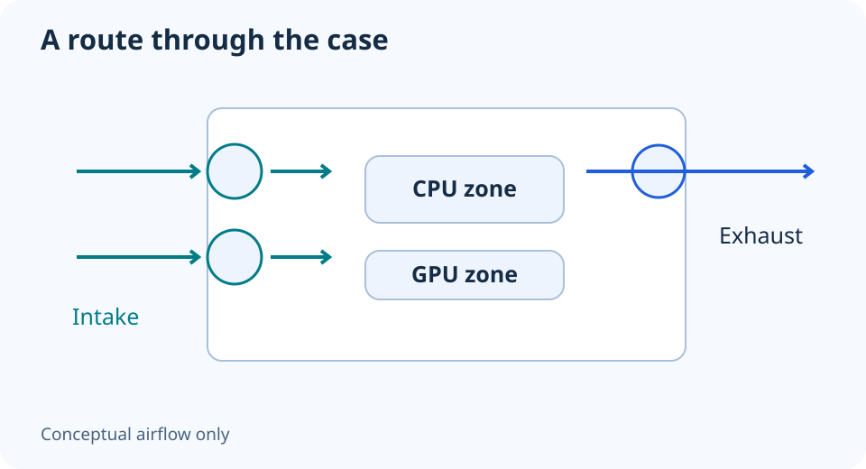

# PC airflow: draw the intake and exhaust path first

**LE-25 · Unpublished research draft · No human editorial review**

Proposed byline: PC Part Performance; requires truthful attribution confirmation.

Intent: Create a case-specific airflow plan and distinguish pressure concepts from measured results

Description: Plan fan direction, filters and obstructions without assuming fan count proves pressure or temperature.

Research date: 2026-10-19. This is not a publication or modification date.

## Short answer

An airflow plan needs a route into and out of the case. Fan direction, filters, speed and obstructions matter; counting intake and exhaust fans alone cannot establish the final balance.

Original schematic; not a manufacturer wiring diagram, product measurement or benchmark.

## Draw a route through the actual case

Mark available intake and exhaust locations, filters, the CPU cooler and GPU. Identify the airflow direction from the fan’s documentation or marked frame. Do not assume the attractive side always faces intake, especially with reverse-blade products.

Noctua’s airflow guidance explains that different case layouts need different arrangements. It distinguishes intake/exhaust balance and cautions against opposing streams and obstructions. Use those principles to ask better questions, not to copy a fan count as a guaranteed cooling result.

Applicable sources: [Noctua: Airflow guide: setup ideas](https://www.noctua.at/en/support/faqs/airflow-guide-setup-ideas).

## Pressure is not a count of matching circles

Positive and negative pressure describe the balance of air entering and leaving. Different fans, speeds, filters and restrictions can change that balance. Three slow filtered intakes and two unrestricted exhausts cannot be classified reliably from the number of fans alone.

Treat pressure language as a planning concept unless you have an appropriate observation or measurement. Do not promise a dust-free PC from “positive pressure,” and do not replace temperature evidence with a diagram. The paths in this guide are conceptual and do not simulate fluid dynamics.

## Test the arrangement you intend to use

Preserve the existing fan locations, settings and workload observations. Change one arrangement or supported setting at a time, then compare under similar ambient conditions. Record noise and temperatures for the workloads that matter rather than optimizing one idle reading.

Check clearances, fan-header load and cable security before operating. Keep the final layout in the build notes, including filter access for cleaning. If adding another fan does not address a demonstrated problem, keeping the simpler setup can be a reasonable outcome. More fans are not automatically more useful.

- Direction verified for each fan
- Intake and exhaust route marked
- Filters and obstructions recorded
- Header/control support checked
- Comparable workload observations retained

## Apply this to your PC

- [Plan case and fan locations](/builder/)
- [Review cooling fit first](/blog/how-to-choose-a-cpu-cooler-that-fits/)

## Research evidence and limitations

### Noctua: Airflow guide: setup ideas

[Original source](https://www.noctua.at/en/support/faqs/airflow-guide-setup-ideas) · Inspected 2026-10-19

Positive/negative pressure refers to intake/exhaust balance; case layouts differ and opposing flows/obstructions matter.

Scope limitation: No fan-count prescription, measured temperature improvement or guaranteed dust prevention imported.

Citation and original explanation only; no source images, diagrams or benchmark tables reproduced.

## Editorial decision still required

Research and draft preparation assisted by AI; no human editorial review or hands-on testing claimed.

Human review: not performed. Publication approval: not granted. No public Article schema, feed, sitemap or blog entry is authorized by this file.

Check the source-linked claims, diagram, safety conditions, search-intent fit and all internal links before deciding. A person must record a truthful complete-article review and byline; automated tests are not that review.

Content fingerprint: `94708802a137cae66ef8f7ace940ca6a585cde4657f951a3b46e6acd2ee585ef`
