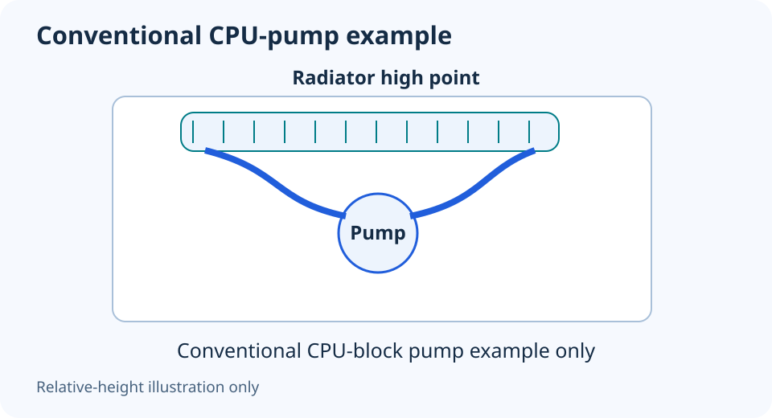

# AIO radiator placement: identify where the pump is

**LE-26 · Unpublished research draft · No human editorial review**

Proposed byline: PC Part Performance; requires truthful attribution confirmation.

Intent: Evaluate AIO orientation using the exact pump location and supported radiator position

Description: Check the cooler layout and mounting instructions before applying a tubes-up or tubes-down rule.

Research date: 2026-10-19. This is not a publication or modification date.

## Short answer

Identify the pump location before applying generic radiator advice. A conventional CPU-block pump and a cooler with a different pump arrangement do not necessarily have the same installation constraints.

Original schematic; not a manufacturer wiring diagram, product measurement or benchmark.

## Find the loop’s actual components

Read the exact cooler manual and identify the pump, radiator, tubes and permitted mounting positions. CORSAIR’s general guidance for a conventional CPU-pump layout keeps the pump below the radiator’s highest point and discusses top mounting or suitable front/tubes-down installation.

That advice is not proof that every AIO has its pump in the CPU block. Do not turn a helpful general drawing into an override of the actual cooler instructions. A bottom-mounted radiator question must be evaluated against the documented pump location and supported configuration.

Applicable sources: [CORSAIR: AIO radiator mounting guidance](https://help.corsair.com/hc/en-us/articles/360049358271-AIO-How-should-I-mount-the-radiator-of-my-AIO-cooler).

## Orientation does not settle physical fit

Check the full radiator/fan envelope, motherboard components, GPU clearance and tube reach for the chosen position. A nominal radiator size does not provide those dimensions. A route that requires pulling the tubes taut or forcing a panel is not established as suitable by an orientation slogan.

Keep fan direction separate from radiator orientation. Record whether the intended position brings air into the case or exhausts it, then consider the rest of the case route. Do not claim a temperature advantage without comparable testing of that complete layout.

## Plan the installation and follow-up

Use only the correct mounting screws and brackets from the product instructions. Improvised long screws or unsupported disassembly can create a new problem. Confirm the required electrical connections and control method separately from the mechanical mounting.

After a supported installation, inspect the reported pump/fan behavior and normal workload temperatures as instructed by the manufacturer. Persistent unusual noise, leaks or abnormal operation should go through the vendor’s support process. Do not open a sealed AIO to “bleed” it as a beginner fix. This illustration explains relative height in a conventional layout; it is not a fit or longevity certificate.

- Exact pump location
- Supported radiator position
- Full fan/radiator/tube envelope
- Correct hardware and electrical connections
- Manufacturer follow-up checks

## Apply this to your PC

- [Check cooler and case fit](/builder/)
- [Review the installed cooling envelope](/blog/how-to-choose-a-cpu-cooler-that-fits/)

## Research evidence and limitations

### CORSAIR: AIO radiator mounting guidance

[Original source](https://help.corsair.com/hc/en-us/articles/360049358271-AIO-How-should-I-mount-the-radiator-of-my-AIO-cooler) · Inspected 2026-10-19

For the conventional CPU-pump layout discussed, keep the pump below the loop’s highest radiator point; top mount or suitable front/tubes-down configurations are described.

Scope limitation: Not every cooler has its pump in the CPU block. Product-specific instructions and case fit override a generic diagram.

Citation and original explanation only; no source images, diagrams or benchmark tables reproduced.

## Editorial decision still required

Research and draft preparation assisted by AI; no human editorial review or hands-on testing claimed.

Human review: not performed. Publication approval: not granted. No public Article schema, feed, sitemap or blog entry is authorized by this file.

Check the source-linked claims, diagram, safety conditions, search-intent fit and all internal links before deciding. A person must record a truthful complete-article review and byline; automated tests are not that review.

Content fingerprint: `39f520bbe5c47e4d5873d2e9d7d4bc9e2f0d7cc8f05c16e7b66e95fcfed7bc97`
