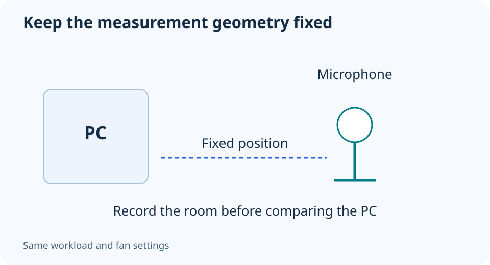

# Measuring PC noise at home: make the comparison repeatable

**LE-27 · Unpublished research draft · No human editorial review**

Proposed byline: PC Part Performance; requires truthful attribution confirmation.

Intent: Create a repeatable home acoustic observation without claiming laboratory-grade dBA results

Description: Record room noise, microphone position and workload before comparing a fan setting or case change.

Research date: 2026-10-19. This is not a publication or modification date.

## Short answer

Use home noise measurements for a carefully documented comparison, not an automatic laboratory rating. The room, microphone and workload can dominate the result.

Original schematic; not a manufacturer wiring diagram, product measurement or benchmark.

## Decide what the measurement can establish

A phone reading near a quiet PC is not automatically comparable with a review laboratory’s dBA result. NIOSH’s official app documentation describes validation under specified conditions and distinguishes calibrated external-microphone use. It does not validate every phone, app or very low sound level.

Do not import the app’s published accuracy into a promise about your PC test. If the source level is close to the room or microphone’s floor, small reported differences may not be meaningful. Avoid declaring a precise noise reduction that the equipment and setup cannot support.

Applicable sources: [CDC/NIOSH: Sound Level Meter app](https://www.cdc.gov/niosh/noise/about/app.html).

## Keep geometry and workload fixed

Mark the microphone position and orientation relative to the case, and keep the same distance for each run. Record the meter/app, weighting or metric, room conditions and background sources. Take an observation with the PC not producing the workload so the background is documented.

Use the same repeatable task and allow the chosen operating state to settle. Keep the fan profile and case configuration with the result. Do not compare an idle measurement from one build with a gaming measurement from another, or move the phone closer after a quieter setting.

## Write down the sound as well as the number

Record rattles, tonal noise and cycling behavior separately from an average level. A single number can conceal a sound you find distracting. Do not diagnose a PSU or pump fault purely from the recording; use the relevant manufacturer’s support instructions.

Change one supported setting at a time and retain the original observations. A useful report can honestly say the measurement setup could not resolve a small difference. This guide provides no measured product ranking, acoustic certification or occupational-exposure advice. Its worksheet helps you make your own observations more consistent.

Home comparison record

| Condition | Keep it fixed or record it |
| --- | --- |
| Geometry | Distance, direction and microphone position |
| Room | Background noise and other operating equipment |
| Workload | Same task and settling behavior |
| Equipment | Meter/app, settings and limitations |
| Perception | Tone, rattle and speed cycling |

## Apply this to your PC

- [Record the configuration under test](/my-pc/)
- [Choose a supported fan-control mode](/builder/)

## Research evidence and limitations

### CDC/NIOSH: Sound Level Meter app

[Original source](https://www.cdc.gov/niosh/noise/about/app.html) · Inspected 2026-10-19

NIOSH validation is scoped to its iOS app and specified test conditions; calibrated external microphone conditions differ from an arbitrary phone reading.

Scope limitation: Not validation at very quiet PC noise levels or proof of a phone’s noise floor. This guide is not occupational exposure advice.

Citation and original explanation only; no source images, diagrams or benchmark tables reproduced.

## Editorial decision still required

Research and draft preparation assisted by AI; no human editorial review or hands-on testing claimed.

Human review: not performed. Publication approval: not granted. No public Article schema, feed, sitemap or blog entry is authorized by this file.

Check the source-linked claims, diagram, safety conditions, search-intent fit and all internal links before deciding. A person must record a truthful complete-article review and byline; automated tests are not that review.

Content fingerprint: `0b03a3a0d46d32df1f8fa21b21a8cb1d4ecda53903082d9865f57f09a2da94a0`
