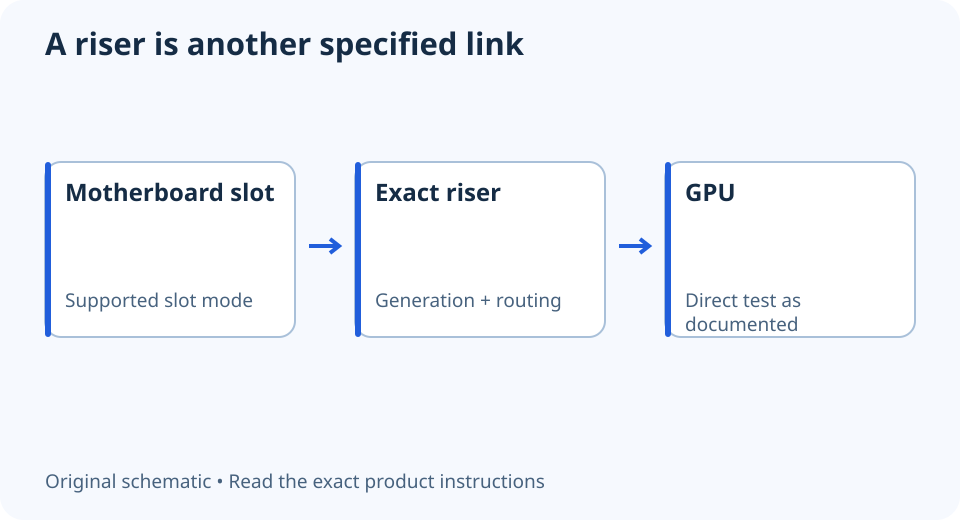

# No display through a PCIe riser? Identify the link first

**LE-28 · Unpublished research draft · No human editorial review**

Proposed byline: PC Part Performance; requires truthful attribution confirmation.

Intent: Investigate a riser-specific no-display problem using documented cable generation and a direct-slot baseline

Description: Separate the GPU, slot and extension cable before changing firmware or replacing a working card.

Research date: 2026-10-19. This is not a publication or modification date.

## Short answer

A riser adds another component to the GPU path. Record its exact model and supported generation before assuming the card, motherboard or driver is faulty.

Original schematic; not a manufacturer wiring diagram, product measurement or benchmark.

## Map the three-part link

Write down the GPU, motherboard slot and extension model. Note whether the same hardware worked when the GPU was mounted directly. A product listing that says only “vertical GPU kit” does not identify the electrical specification of the included riser.

CORSAIR documents a specific case in which its PCIe 3.0 extension with PCIe 4.0 hardware may need a supported Gen3 setting. It first directs the reader to mount the GPU directly to access firmware. That is a named older-cable scenario, not a universal instruction to force every system to Gen3.

Applicable sources: [CORSAIR: PCIe 3.0 extension video-output troubleshooting](https://help.corsair.com/hc/en-us/articles/360052676711-PCIe-3-0-Extension-How-to-fix-video-outputting-issues-when-using-the-CORSAIR-PCIe-3-0-extension-cable).

## Preserve a safe working baseline

Follow the case and board instructions for power disconnection, handling and mounting before changing hardware. If a direct installation is physically supported, it can help separate extension-path behavior from a broader no-display fault. Keep the exact observation and configuration in the notes.

If direct mounting does not work either, do not keep applying the riser-specific explanation. Follow the wider no-display checks and manufacturer support. If the case cannot accommodate a supported direct test, obtain an appropriate service path rather than operating an improvised unsecured assembly.

## Change only a documented setting

Use the board and cable manufacturers’ instructions to identify any applicable link-mode setting. Record its previous value and the supported rollback route. Firmware updates or resets can change settings later, so retain the riser requirement with the build revision.

Do not assume a lower negotiated mode is a performance measurement or that a newer-generation cable cures every problem. Inspect supported routing, connector condition and mounting without forcing the cable. A useful outcome is a documented direct-slot pass and riser-path failure that support can reproduce, rather than an unsupported declaration that the GPU is defective.

- Exact riser model and generation
- GPU and slot identified
- Supported direct-slot baseline
- Applicable manufacturer setting only
- Original firmware value retained

## Apply this to your PC

- [Record the complete GPU path](/builder/)
- [Use the wider no-display checklist](/blog/new-pc-no-display-safe-checks/)

## Research evidence and limitations

### CORSAIR: PCIe 3.0 extension video-output troubleshooting

[Original source](https://help.corsair.com/hc/en-us/articles/360052676711-PCIe-3-0-Extension-How-to-fix-video-outputting-issues-when-using-the-CORSAIR-PCIe-3-0-extension-cable) · Inspected 2026-10-19

For the named Gen3 extension with Gen4 devices, direct mounting allows access to firmware before selecting Gen3 and retrying the extension.

Scope limitation: Exact named older extension scenario only; not a blanket fix for all risers or a recommendation to force any unknown link mode.

Citation and original explanation only; no source images, diagrams or benchmark tables reproduced.

## Editorial decision still required

Research and draft preparation assisted by AI; no human editorial review or hands-on testing claimed.

Human review: not performed. Publication approval: not granted. No public Article schema, feed, sitemap or blog entry is authorized by this file.

Check the source-linked claims, diagram, safety conditions, search-intent fit and all internal links before deciding. A person must record a truthful complete-article review and byline; automated tests are not that review.

Content fingerprint: `54982b91916e6c83a04b606bf12aaa02aa319f4d40b4ecd46feb2a50b7cd8c43`
