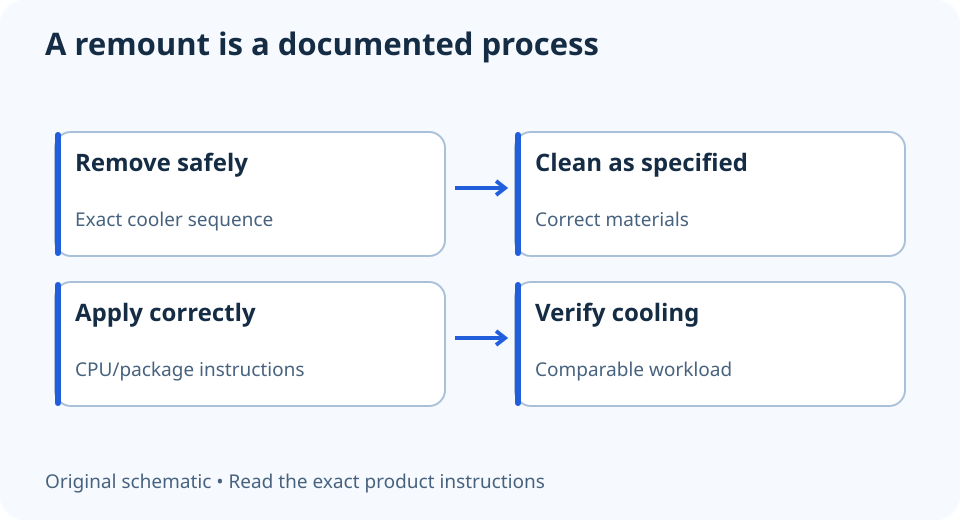

# Thermal paste after removing a CPU cooler: what to check

**LE-29 · Unpublished research draft · No human editorial review**

Proposed byline: PC Part Performance; requires truthful attribution confirmation.

Intent: Plan a cooler remount without reusing an uncertain thermal interface or copying a universal paste dose

Description: Use exact compound and cooler instructions, renew the interface appropriately and avoid replacing paste on an invented schedule.

Research date: 2026-10-19. This is not a publication or modification date.

## Short answer

Removing a cooler changes the thermal interface. Follow the compound and cooler instructions for cleaning and fresh application rather than assuming the disturbed layer is reusable.

Original schematic; not a manufacturer wiring diagram, product measurement or benchmark.

## Use the instructions for your materials

Noctua recommends cleaning the CPU and heatsink contact surfaces and reapplying compound after removing the heatsink when using its NT-H1/NT-H2 guidance. The application amount and method need the appropriate CPU/package instructions. This does not establish a universal pattern for every paste or processor.

Also identify any factory-applied interface before adding more. Do not combine an unknown compound with fresh material or treat liquid metal as interchangeable with conventional paste. If the cooler or CPU has a special handling requirement, follow that product’s documentation.

Applicable sources: [Noctua: NT-H1/NT-H2 application and removal](https://www.noctua.at/en/support/faqs/how-should-i-apply-the-nt-h1-or-nt-h2-thermal-paste-on-the-cpu-and-how-can-i-remove-it).

## Separate a remount from routine maintenance

A disturbed interface is a specific event. It does not prove that every working PC needs paste replacement at the same age. Preserve the operating baseline and identify the actual symptom before dismantling a reliable system because of an arbitrary calendar rule.

A high temperature can have several causes: mounting, fan behavior, airflow, workload or settings. Record what changed and check the relevant instructions. Do not interpret one temperature screenshot as proof the paste is exhausted, and do not use a remount to hide an unresolved fan or pump problem.

## Keep the remount procedure controlled

Disconnect power and follow the exact cooler removal sequence. Protect the socket and nearby components, use the documented cleaning materials, and allow any required preparation before installation. Do not scrape contact surfaces with improvised metal tools or mix cleaning instructions from unrelated products.

After installing with the specified hardware and sequence, reconnect and verify the cooling controls, then compare an appropriate normal workload with the baseline. Keep the compound model and remount date in your maintenance notes. This guide offers no measured paste ranking, promised temperature reduction or universal tightening torque.

- Exact cooler and compound identified
- Product removal and cleaning instructions
- Fresh interface where required
- Correct mounting hardware and sequence
- Fan/pump connections verified
- Comparable follow-up observation

## Apply this to your PC

- [Keep cooler and maintenance notes](/my-pc/)
- [Check physical cooler fit](/blog/how-to-choose-a-cpu-cooler-that-fits/)

## Research evidence and limitations

### Noctua: NT-H1/NT-H2 application and removal

[Original source](https://www.noctua.at/en/support/faqs/how-should-i-apply-the-nt-h1-or-nt-h2-thermal-paste-on-the-cpu-and-how-can-i-remove-it) · Inspected 2026-10-19

When the heatsink is removed, Noctua recommends cleaning both contact surfaces and applying fresh compound; application instructions depend on the CPU/package.

Scope limitation: Only NT-H1/NT-H2 and relevant instructions; not a universal dose, replacement interval, or instruction for liquid metal.

Citation and original explanation only; no source images, diagrams or benchmark tables reproduced.

## Editorial decision still required

Research and draft preparation assisted by AI; no human editorial review or hands-on testing claimed.

Human review: not performed. Publication approval: not granted. No public Article schema, feed, sitemap or blog entry is authorized by this file.

Check the source-linked claims, diagram, safety conditions, search-intent fit and all internal links before deciding. A person must record a truthful complete-article review and byline; automated tests are not that review.

Content fingerprint: `2c4eaa254b6a821156cdb1cd051ae332dc2fa8e8d39a5c2a7568916792f4ea63`
