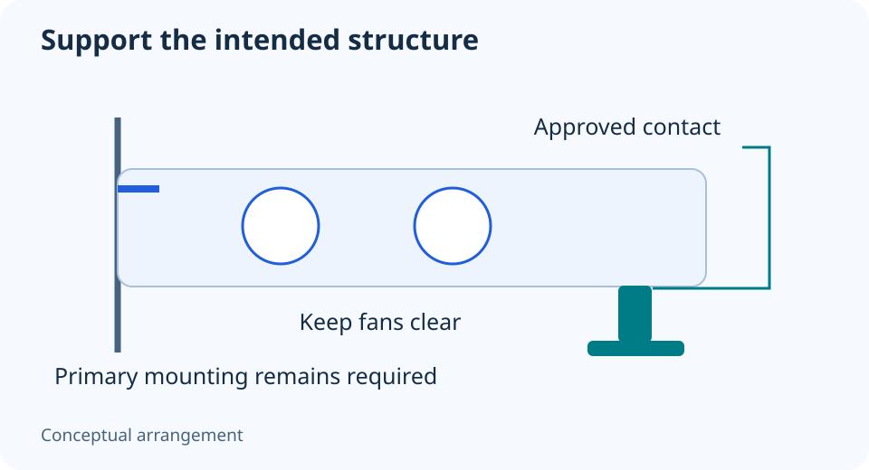

# GPU support brackets: support the card without creating a new obstruction

**LE-30 · Unpublished research draft · No human editorial review**

Proposed byline: PC Part Performance; requires truthful attribution confirmation.

Intent: Install a documented GPU support without pushing on fans or unknown components

Description: Check supplied accessories, chassis anchoring and contact points before placing a support under a graphics card.

Research date: 2026-10-19. This is not a publication or modification date.

## Short answer

Use the card or holder manufacturer’s installation method. A support must stabilize the intended structure without pressing on fans, cables or unsupported surfaces.

Original schematic; not a manufacturer wiring diagram, product measurement or benchmark.

## Identify the holder and its intended contact

ASUS’s support article first checks whether the exact card includes a holder, then uses named card/case examples for installation. It secures the card to the chassis before adjusting the support. These details are useful because a stand is not a substitute for the primary mounting hardware.

Do not turn the example’s contact location into a universal rule. Cards have different housings, fan positions and structural surfaces. Read the exact support instructions and accessory list, including whether a chassis rail, magnetic base or model-specific bracket is required.

Applicable sources: [ASUS: Installing the supplied graphics-card holder](https://www.asus.com/us/support/faq/1054765/).

## Inspect the surrounding space

Check that the holder cannot contact fan blades, block an intake, pull a cable or conflict with a lower expansion card. A flat-looking surface in a photograph may be a moving fan or thin decorative cover. Do not choose a support point from appearance alone.

Adjust only as the instructions describe; do not jack the card upward to make it look perfectly level. If the chassis mounting and specified holder cannot be arranged safely, leave the question unresolved and ask the manufacturer. A generic 3D model cannot prove a load-bearing contact point.

## Record the installed arrangement

Follow the manuals’ power-disconnection precautions before working. Verify the slot latch and chassis fastening according to the board/card instructions, then check that the support remains secure. Keep photographs of the supported arrangement without exposing serial numbers in public build shares.

Recheck after moving the PC or changing the card, but do not assume the support makes shipping an assembled heavy GPU safe. Use the system maker’s transport guidance. This guide contains no allowable sag measurement, structural certification or promise that a universal stand fits every card.

- Exact support and card instructions
- Primary mounting secure
- Approved structural contact
- Fan/cable/slot clearance
- No forced lifting
- Transport guidance checked separately

## Apply this to your PC

- [Record the exact GPU and case](/builder/)
- [Keep installation notes](/my-pc/)

## Research evidence and limitations

### ASUS: Installing the supplied graphics-card holder

[Original source](https://www.asus.com/us/support/faq/1054765/) · Inspected 2026-10-19

Check exact-card accessory list; secure the card to the chassis; position the supported holder as specified without interference.

Scope limitation: Examples use particular ASUS products; no universal support location or guarantee for arbitrary heavy cards.

Citation and original explanation only; no source images, diagrams or benchmark tables reproduced.

## Editorial decision still required

Research and draft preparation assisted by AI; no human editorial review or hands-on testing claimed.

Human review: not performed. Publication approval: not granted. No public Article schema, feed, sitemap or blog entry is authorized by this file.

Check the source-linked claims, diagram, safety conditions, search-intent fit and all internal links before deciding. A person must record a truthful complete-article review and byline; automated tests are not that review.

Content fingerprint: `27c7b6f7b4c2e54dc8680ae0b1f2041f984ded44e2fd6bf0c70ecc4cce83623c`
