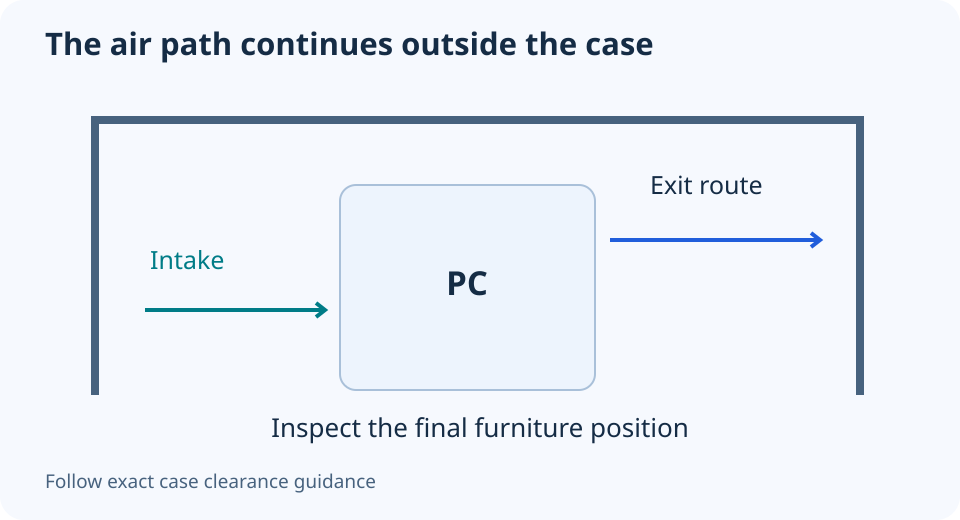

# Putting a PC under a desk: check the air path before the fans

**LE-31 · Unpublished research draft · No human editorial review**

Proposed byline: PC Part Performance; requires truthful attribution confirmation.

Intent: Evaluate desk and cabinet placement as part of the PC ventilation plan

Description: Inspect rear exhaust, side intakes, floor clearance and cabinet recirculation before buying more cooling.

Research date: 2026-10-19. This is not a publication or modification date.

## Short answer

Case ventilation continues outside the chassis. A clear internal fan layout cannot compensate for blocked vents or warm air trapped in an unsuitable enclosure.

Original schematic; not a manufacturer wiring diagram, product measurement or benchmark.

## Inspect the installed position

Identify where the case actually takes in and expels air. Check the rear gap, side panels, underside intake and access to filters. Do not assume all tower cases draw from the front, or that the desk’s open front provides a free exit at the rear.

Dell’s desktop-care guidance warns against blocked vents, soft surfaces and enclosures without adequate ventilation. Its numeric clearance examples are for that guidance; they are not a universal allowance for every DIY case. Use the exact chassis/system instructions for required spacing.

Applicable sources: [Dell: Desktop care and ventilation](https://www.dell.com/support/kbdoc/en-us/000184427/best-practices-for-product-use-and-handling-for-dell-desktops).

## Look for recirculation and obstruction

A cabinet can allow the hot exhaust to return to an intake or collect around the system. Cables, a wall and stored objects can change the effective route. Check the final working position with the panels and doors as they will actually be used.

Do not place a bottom-intake system directly onto a surface that obstructs it. Use a stable, supported arrangement consistent with the case guidance. Avoid improvised stands that could tip, block vents or strain cables. Preserve safe access to power and maintenance.

## Compare placement before changing hardware

Record the workload and normal temperature/fan observations in the original position. If a supported alternative location is available, compare under similar room conditions while changing only the position. Do not treat an uncontrolled open-panel test as the final normal configuration.

If placement explains an issue, more fans may not be the useful first purchase. Keep the chosen location and required clearances in the PC’s maintenance notes, and recheck after moving furniture. This guide supplies no guaranteed temperature drop or measured airflow calculation; its diagram illustrates the surrounding route you need to inspect.

- All vent locations identified
- Exact maker spacing retained
- No soft-surface obstruction
- Exhaust can leave the furniture
- Stable mounting and maintenance access
- Comparable observations before new hardware

## Apply this to your PC

- [Record the case and fan layout](/builder/)
- [Keep placement in your maintenance notes](/my-pc/)

## Research evidence and limitations

### Dell: Desktop care and ventilation

[Original source](https://www.dell.com/support/kbdoc/en-us/000184427/best-practices-for-product-use-and-handling-for-dell-desktops) · Inspected 2026-10-19

Avoid blocked vents, soft surfaces and unventilated enclosures; preserve the manufacturer’s clearance guidance.

Scope limitation: Dell’s specific numeric spacing examples are not a universal DIY case clearance rule.

Citation and original explanation only; no source images, diagrams or benchmark tables reproduced.

## Editorial decision still required

Research and draft preparation assisted by AI; no human editorial review or hands-on testing claimed.

Human review: not performed. Publication approval: not granted. No public Article schema, feed, sitemap or blog entry is authorized by this file.

Check the source-linked claims, diagram, safety conditions, search-intent fit and all internal links before deciding. A person must record a truthful complete-article review and byline; automated tests are not that review.

Content fingerprint: `811d653947c033b45729e653323ae01312accfabf8cf929ac678804f3526f0c3`
