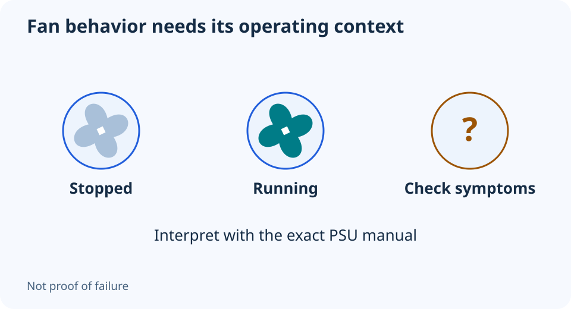

# PSU fan not spinning? Check whether zero-RPM mode is expected

**LE-32 · Unpublished research draft · No human editorial review**

Proposed byline: PC Part Performance; requires truthful attribution confirmation.

Intent: Distinguish documented zero-RPM behavior from a symptom that needs manufacturer support

Description: Identify semi-passive behavior from the exact power-supply manual without diagnosing health from fan motion alone.

Research date: 2026-10-19. This is not a publication or modification date.

## Short answer

Some PSUs intentionally stop their fan under suitable operating conditions. A stationary fan alone proves neither a healthy PSU nor a failed one.

Original schematic; not a manufacturer wiring diagram, product measurement or benchmark.

## Find the exact model’s normal behavior

CORSAIR describes zero-RPM operation on certain models and says the default behavior belongs in the unit’s manual. The applicable control can depend on the product. Do not assume a relative’s similar-looking PSU has the same threshold or software control.

Record the full PSU part number, revision and operating conditions. A wattage headline or efficiency badge does not identify the fan policy. Nor does zero-RPM branding establish measured acoustic quality, protections or suitability for a particular build.

Applicable sources: [CORSAIR: Zero-RPM power supplies](https://help.corsair.com/hc/en-us/articles/4415184478477-PSU-What-are-zero-RPM-PSUs).

## Keep observations separate from conclusions

Note whether the PC is operating normally, whether the fan follows the documented behavior, and whether there are shutdowns, unusual smells or other symptoms. Do not repeatedly create an extreme workload just to force the fan to spin. A visual observation is not a load test or an electrical-health measurement.

If behavior conflicts with the manual or there are signs of damage, stop and use the manufacturer’s support process. Do not open the PSU, insert objects through its grille or override its protections. This guide does not reproduce improvised paperclip or live-voltage testing instructions.

## Consider the installation around the PSU

Check that intake and exhaust openings are unobstructed and the orientation follows the case and PSU instructions. A quiet fan setting does not make a blocked intake acceptable. Keep dust-filter maintenance accessible without modifying the unit.

When shopping, compare exact supported connections, fit and relevant independent testing rather than buying solely for a stopped-fan mode. If the current documented behavior is normal and the system meets its requirements, the observation may call for no purchase at all. Save the manual and useful symptoms with the PC record so the next investigation starts with an exact model.

- Exact PSU identified
- Manual’s normal fan behavior checked
- Other symptoms recorded
- Ventilation unobstructed
- No enclosure opening or improvised live test
- Support used for abnormal behavior

## Apply this to your PC

- [Record PSU identity and condition](/my-pc/)
- [Plan a replacement only when justified](/upgrade/)

## Research evidence and limitations

### CORSAIR: Zero-RPM power supplies

[Original source](https://help.corsair.com/hc/en-us/articles/4415184478477-PSU-What-are-zero-RPM-PSUs) · Inspected 2026-10-19

Some PSU fans remain stopped under suitable conditions and start according to the model’s documented control behavior.

Scope limitation: No universal wattage/temperature threshold. A stationary fan is neither sufficient proof of health nor of failure.

Citation and original explanation only; no source images, diagrams or benchmark tables reproduced.

## Editorial decision still required

Research and draft preparation assisted by AI; no human editorial review or hands-on testing claimed.

Human review: not performed. Publication approval: not granted. No public Article schema, feed, sitemap or blog entry is authorized by this file.

Check the source-linked claims, diagram, safety conditions, search-intent fit and all internal links before deciding. A person must record a truthful complete-article review and byline; automated tests are not that review.

Content fingerprint: `e565945b6ab2ff5e86f3863cf14a2febb72a319300bfb3c440d66c98365b975b`
