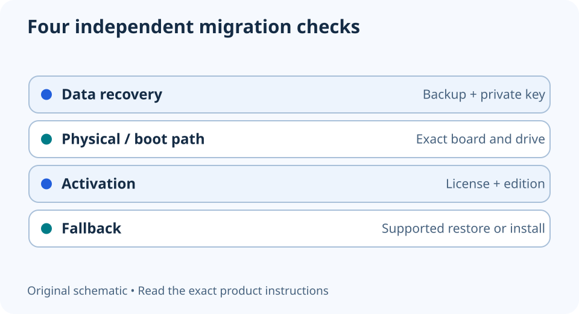

# Moving a Windows SSD to a new motherboard: prepare before the swap

**LE-33 · Unpublished research draft · No human editorial review**

Proposed byline: PC Part Performance; requires truthful attribution confirmation.

Intent: Prepare a recoverable Windows system-drive move without promising it will boot unchanged

Description: Separate physical storage fit, boot support, encrypted-data access and Windows activation before changing the platform.

Research date: 2026-10-19. This is not a publication or modification date.

## Short answer

A drive fitting the new board does not guarantee that the current Windows installation will boot or reactivate. Prepare a backup, encrypted-drive recovery and an installation plan before dismantling the working PC.

Original schematic; not a manufacturer wiring diagram, product measurement or benchmark.

## Protect access to the data first

Make a recoverable backup and confirm how you would restore essential files without the old motherboard. If the drive is encrypted, verify access to the correct recovery key from a separate device or secure offline record before the change. Do not put that key into a public build note or share URL.

Microsoft explains that hardware changes can trigger BitLocker recovery and that it cannot recreate a lost recovery key. A password you remember and an account you can access are not a substitute for checking the actual recovery record that applies to this drive.

Applicable sources: [Microsoft: Find your BitLocker recovery key](https://support.microsoft.com/en-us/windows/security/encryption/find-your-bitlocker-recovery-key).

## Keep boot support and activation as separate tasks

Check the new board’s supported storage interface and boot requirements against the existing installation. Record the old firmware/storage configuration and obtain official support instructions and drivers for the new platform. Do not switch boot or controller modes as a guess when the data has no recovery path.

Microsoft says a major hardware change such as a motherboard replacement can require Windows reactivation. Record the edition and activation method and read the applicable license conditions. Linking a digital license to an account may support the documented reactivation process; it does not create transfer rights that the license never had.

Applicable sources: [Microsoft: Reactivating Windows after a hardware change](https://support.microsoft.com/en-us/windows/activation/reactivating-windows-after-a-hardware-change).

## Choose the fallback before starting

Decide whether the supported plan is to move the existing installation, migrate data into a fresh supported installation, or obtain qualified help. Keep official installation media and essential drivers available where needed. A clean installation can erase data, so identify the intended drive and recovery requirements before proceeding.

After a successful change, verify detected hardware, updates, activation and normal workloads before deleting old recovery material. Preserve the old configuration record so problems have context. This guide offers preparation, not a guarantee of an in-place migration or an instruction to disable security features to force a boot.

- Restorable backup confirmed
- Correct recovery key accessible privately
- New storage/boot path documented
- Edition and activation method recorded
- Official drivers and fallback available
- Post-change verification planned

## Apply this to your PC

- [Compare the complete platform change](/upgrade/)
- [Record the new storage arrangement](/builder/)

## Research evidence and limitations

### Microsoft: Find your BitLocker recovery key

[Original source](https://support.microsoft.com/en-us/windows/security/encryption/find-your-bitlocker-recovery-key) · Inspected 2026-10-19

Hardware changes can trigger recovery; the correct recovery key must remain accessible; Microsoft cannot recreate a lost key.

Scope limitation: No secrets are collected by the site, and no encryption bypass or guarantee of recovery is offered.

Citation and original explanation only; no source images, diagrams or benchmark tables reproduced.

### Microsoft: Reactivating Windows after a hardware change

[Original source](https://support.microsoft.com/en-us/windows/activation/reactivating-windows-after-a-hardware-change) · Inspected 2026-10-19

A motherboard change can require reactivation; preserve activation method and edition, and use Microsoft’s supported recovery path.

Scope limitation: License transfer rights vary; linking an account does not create a new transferable license.

Citation and original explanation only; no source images, diagrams or benchmark tables reproduced.

## Editorial decision still required

Research and draft preparation assisted by AI; no human editorial review or hands-on testing claimed.

Human review: not performed. Publication approval: not granted. No public Article schema, feed, sitemap or blog entry is authorized by this file.

Check the source-linked claims, diagram, safety conditions, search-intent fit and all internal links before deciding. A person must record a truthful complete-article review and byline; automated tests are not that review.

Content fingerprint: `652b1d828a052f345003489d58fe71c145e0e24f26e4f744e40b46a19daa6c12`
