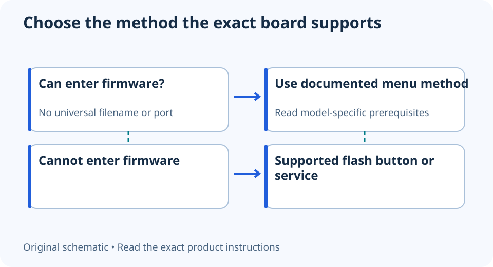

# BIOS Flashback vs a normal BIOS update: choose the documented route

**LE-34 · Unpublished research draft · No human editorial review**

Proposed byline: PC Part Performance; requires truthful attribution confirmation.

Intent: Choose an exact motherboard’s supported firmware-update method before a CPU upgrade

Description: Check whether the board can update without a supported CPU, then follow its exact file, port and power instructions.

Research date: 2026-10-19. This is not a publication or modification date.

## Short answer

A firmware-menu update needs a system that can reach that utility. Supported button-based flash features can provide a different route, but they exist only on particular boards and have their own instructions.

Original schematic; not a manufacturer wiring diagram, product measurement or benchmark.

## Start with what the board can do now

Record the full board model, hardware revision, installed BIOS if known and the CPU currently available. Determine whether the PC can enter the firmware utility. A button on the rear panel is not automatically a flash feature; identify its documented function.

ASUS distinguishes its firmware-menu method from USB BIOS FlashBack on supported models. MSI’s Flash BIOS Button instructions also explicitly limit the method to equipped boards. Do not apply a filename, USB-port choice or waiting-time rule from one brand to another.

Applicable sources: [ASUS: Motherboard BIOS update methods](https://www.asus.com/support/faq/1044348/); [MSI: Flash BIOS Button](https://www.msi.com/support/technical_details/MB_Flash_BIOS_Button).

## Check the entire update path

Find the target CPU in the exact support list and read the firmware release notes and prerequisites. Check whether an intermediate version or additional firmware step is required. If the system cannot boot with the available CPU and has no supported independent flash method, arrange a documented service or supported-CPU path.

Use only the official file for the exact board/revision. Keep any required recovery information and backup before changing firmware. Do not assume rollback is always possible or that a file with a similar name belongs to the board.

Applicable sources: [ASUS: Motherboard BIOS update methods](https://www.asus.com/support/faq/1044348/).

## Keep the procedure beside the hardware

Follow that product’s instructions for USB preparation, supplied power connections, designated port and completion indication. Maintain power as required and do not interrupt an active update. If the indications do not match the manual, use official support rather than guessing whether another press or unplugging will help.

After completion, verify the installed version and recheck settings that matter to the configuration. A firmware update does not certify RAM profiles, clearances or every connected component. Save the method and version with the CPU-support evidence so future upgrades start from a documented state.

- Exact model/revision
- Current ability to enter firmware
- Official CPU support and prerequisites
- Supported method and exact instructions
- Backup/recovery readiness
- Completion and installed version verified

Applicable sources: [MSI: Flash BIOS Button](https://www.msi.com/support/technical_details/MB_Flash_BIOS_Button).

## Apply this to your PC

- [Check CPU and board support](/compatibility/)
- [Plan the platform upgrade](/upgrade/)

## Research evidence and limitations

### ASUS: Motherboard BIOS update methods

[Original source](https://www.asus.com/support/faq/1044348/) · Inspected 2026-10-19

Firmware-menu updating and supported USB BIOS FlashBack are different methods; some upgrades require an intermediate version or old supported CPU/service.

Scope limitation: Cannot assume rollback is always possible; exact board revision/support instructions remain required.

Citation and original explanation only; no source images, diagrams or benchmark tables reproduced.

### MSI: Flash BIOS Button

[Original source](https://www.msi.com/support/technical_details/MB_Flash_BIOS_Button) · Inspected 2026-10-19

Only supported models provide the button-based method; the correct model file, designated USB port and uninterrupted power matter.

Scope limitation: No universal filename, wait time or electrical sequence applied to other board manufacturers.

Citation and original explanation only; no source images, diagrams or benchmark tables reproduced.

## Editorial decision still required

Research and draft preparation assisted by AI; no human editorial review or hands-on testing claimed.

Human review: not performed. Publication approval: not granted. No public Article schema, feed, sitemap or blog entry is authorized by this file.

Check the source-linked claims, diagram, safety conditions, search-intent fit and all internal links before deciding. A person must record a truthful complete-article review and byline; automated tests are not that review.

Content fingerprint: `7ff07cc87564e3f1ce72f41e416020bc616955a18775920c8307316d29d2ef1a`
