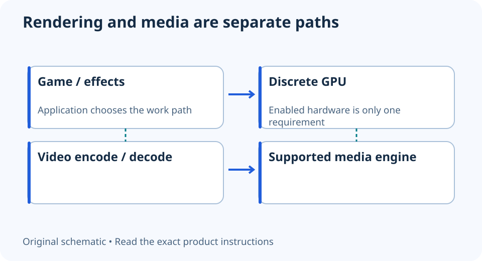

# Quick Sync with a discrete GPU: keep the media path in view

**LE-35 · Unpublished research draft · No human editorial review**

Proposed byline: PC Part Performance; requires truthful attribution confirmation.

Intent: Verify processor-graphics Quick Sync availability alongside a discrete GPU

Description: Check processor graphics, firmware, driver and application support instead of assuming the gaming GPU does every video task.

Research date: 2026-10-19. This is not a publication or modification date.

## Short answer

A discrete graphics card does not automatically make processor-graphics media acceleration irrelevant. For the Quick Sync path discussed here, Intel says the integrated graphics must remain enabled.

Original schematic; not a manufacturer wiring diagram, product measurement or benchmark.

## Identify the media engine separately from rendering

Video decoding, encoding and game rendering are different jobs. Intel’s support guidance says processor-graphics Quick Sync depends on the iGPU being enabled, even when a separate GPU is present. A motherboard display connector alone is not evidence that the installed CPU has the required graphics.

Record the exact processor, its graphics capability, firmware configuration and driver. This is not a statement about every Intel Arc discrete encoder, every codec or every processor with a similar retail name. Use the exact hardware and application support records.

Applicable sources: [Intel: Quick Sync with a separate GPU](https://www.intel.com/content/www/us/en/support/articles/000094565/graphics.html).

## Trace the actual application path

Check whether the editor or recording application supports the required hardware path for the source codec, bit depth and output format. A checkbox called hardware acceleration may cover only part of the workflow. Preserve the application version and the selected decode or encode setting.

OBS’s hardware-encoding guidance provides an application-level starting point when OBS is the actual tool. Do not transfer its options into a different editor as a universal procedure. A supported encoder being available is not proof that the project uses it or that every effect becomes GPU-accelerated.

Applicable sources: [OBS Project: Hardware encoding](https://obsproject.com/kb/hardware-encoding).

## Test the workflow rather than buy from a logo

Use a representative project or recording and inspect successful output, playback and relevant application reporting. Keep the same input and settings when comparing paths. Do not claim a speedup from a different preset, changed quality or a marketing label.

If considering a CPU without integrated graphics, include the media requirement in the complete platform decision. If the current setup already performs the task, no upgrade may be needed. This guide supplies no export benchmark or blanket CPU recommendation; it helps prevent a useful capability from being silently disabled or assumed.

- Exact CPU graphics capability
- iGPU state documented
- Supported driver
- Application and format support
- Representative output verified
- Rendering and media claims separated

## Apply this to your PC

- [Compare exact CPU capabilities](/compare/)
- [Plan around the editing project](/blog/video-editing-pc-workload-checklist/)

## Research evidence and limitations

### Intel: Quick Sync with a separate GPU

[Original source](https://www.intel.com/content/www/us/en/support/articles/000094565/graphics.html) · Inspected 2026-10-19

Processor-graphics Quick Sync acceleration depends on the integrated graphics remaining enabled.

Scope limitation: Does not certify every codec/profile or an exact export-speed improvement; this discussion is distinct from Intel Arc discrete media support.

Citation and original explanation only; no source images, diagrams or benchmark tables reproduced.

### OBS Project: Hardware encoding

[Original source](https://obsproject.com/kb/hardware-encoding) · Inspected 2026-10-19

Available hardware encoders depend on hardware and software; selection belongs in the recording/streaming workflow.

Scope limitation: An encoder being selectable does not establish service acceptance, quality equivalence or zero performance cost.

Citation and original explanation only; no source images, diagrams or benchmark tables reproduced.

## Editorial decision still required

Research and draft preparation assisted by AI; no human editorial review or hands-on testing claimed.

Human review: not performed. Publication approval: not granted. No public Article schema, feed, sitemap or blog entry is authorized by this file.

Check the source-linked claims, diagram, safety conditions, search-intent fit and all internal links before deciding. A person must record a truthful complete-article review and byline; automated tests are not that review.

Content fingerprint: `43e6cec364d03d6ac675e6552527fc1e4c83703deb393e963fe761934cb39b9d`
