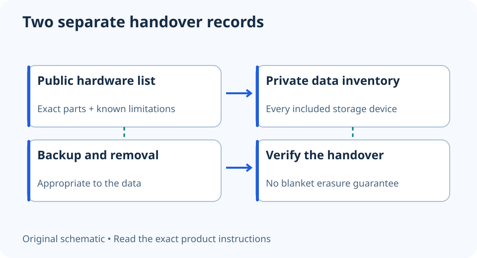

# Preparing a PC for sale: separate hardware records from private data

**LE-36 · Unpublished research draft · No human editorial review**

Proposed byline: PC Part Performance; requires truthful attribution confirmation.

Intent: Prepare a Windows PC ownership handover with a storage inventory and appropriate data-removal limits

Description: Back up, identify every storage device and use an appropriate data-removal process before handing over a computer.

Research date: 2026-10-19. This is not a publication or modification date.

## Short answer

Prepare the hardware description and data-removal plan separately. Removing an account or deleting visible files is not the same as clearing every drive appropriately.

Original schematic; not a manufacturer wiring diagram, product measurement or benchmark.

## Inventory what will leave your ownership

Record every internal drive, removable card and external device included in the sale. Distinguish items you will retain. Prepare a public hardware list with exact models and known limitations, while keeping invoices, keys, serial records and personal notes private where appropriate.

Make and verify the backups you need before starting removal. Microsoft’s handover guidance begins with backing up and resetting the device, then removing it from the account. Do not confuse removing an entry from an online account with erasing data still stored on the machine.

Applicable sources: [Microsoft: Before selling, recycling or gifting a Windows PC](https://support.microsoft.com/en-us/accounts-billing/security/before-you-recycle-sell-or-gift-your-xbox-or-windows-pc).

## Choose a process appropriate to the data and drive

Microsoft distinguishes Keep my files from Remove everything and provides a drive-cleaning option for a consumer handover. It explicitly does not present that cleaning feature as meeting government or industry sanitization standards. Do not market a reset as certified erasure of all devices.

For sensitive or managed data, use the organization’s approved process or qualified service. For each storage device, follow the relevant manufacturer and operating-system instructions. Do not run a generic erase command against an unconfirmed disk, and do not assume a reset option covered an additional drive you never checked.

Applicable sources: [Microsoft: Reset your PC](https://support.microsoft.com/en-us/windows/experience/backup-recovery/reset-your-pc).

## Verify the handover without signing back into private services

Confirm the intended removal completed and that retained drives or removable media have not been left in the case. Keep a record of the process and outcome without exposing the old owner’s recovery keys or personal files. Follow the supported setup/transfer path rather than creating a fake new-owner identity.

Provide an honest configuration list, accessories, relevant manuals and known faults. Do not promise warranty transfer without checking the product’s terms. If the device cannot complete a suitable removal process, keep the storage or obtain the appropriate service instead of assuming broken hardware makes the data inaccessible.

- All storage identified
- Backups checked
- Removal method appropriate to data
- Each included drive accounted for
- Accounts handled through official process
- Public hardware record excludes private secrets
- Known faults disclosed

## Apply this to your PC

- [Prepare a clean parts record](/my-pc/)
- [Compare keeping and replacing parts](/upgrade/)

## Research evidence and limitations

### Microsoft: Before selling, recycling or gifting a Windows PC

[Original source](https://support.microsoft.com/en-us/accounts-billing/security/before-you-recycle-sell-or-gift-your-xbox-or-windows-pc) · Inspected 2026-10-19

Back up, reset appropriately and remove the retired device from the Microsoft account after the required preparation.

Scope limitation: Account removal alone does not erase local storage; no claim of certified sanitization for sensitive data.

Citation and original explanation only; no source images, diagrams or benchmark tables reproduced.

### Microsoft: Reset your PC

[Original source](https://support.microsoft.com/en-us/windows/experience/backup-recovery/reset-your-pc) · Inspected 2026-10-19

Back up before reset; Keep my files and Remove everything differ; drive cleaning makes recovery harder but is not a government/industry sanitization standard.

Scope limitation: No universal secure-erasure guarantee for every drive, recovery partition, external device or sensitive-data use case.

Citation and original explanation only; no source images, diagrams or benchmark tables reproduced.

## Editorial decision still required

Research and draft preparation assisted by AI; no human editorial review or hands-on testing claimed.

Human review: not performed. Publication approval: not granted. No public Article schema, feed, sitemap or blog entry is authorized by this file.

Check the source-linked claims, diagram, safety conditions, search-intent fit and all internal links before deciding. A person must record a truthful complete-article review and byline; automated tests are not that review.

Content fingerprint: `6af38b783c8df037ec50d8496201fc1b5300aac222bb854ce94204f28a729ea3`
